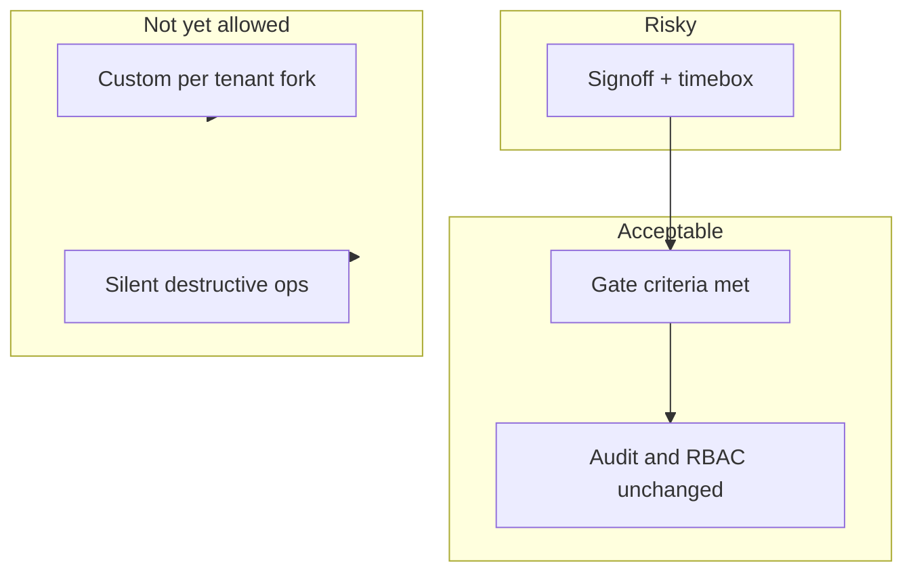

# Expansion guardrails (beyond early pilots)

This defines **acceptable**, **risky**, and **not yet allowed** expansion so product, CS, and engineering do not confuse motion with progress. It aligns with [INCREMENTAL_PRODUCT_GATES.md](./INCREMENTAL_PRODUCT_GATES.md), [RETENTION_BACKLOG.md](./RETENTION_BACKLOG.md), and default caps in [`plan-limits.config.ts`](../../apps/api/src/commerce/plan-limits.config.ts) (trial: 1 branch / 5 users; starter: 1/10; growth: 5/50; scale: high caps with product judgment).

---

## 1. Expansion risk categories

| Category | Meaning | Examples |
|----------|---------|----------|
| **Acceptable expansion** | Fits monolith + narrow-SKU strategy; support and engineering can absorb; audit and guardrails stay intact. | Another pilot in same deployment playbook; one more branch after prior branch is **live** and healthy; self-serve flows that are permission-gated, rate-limited, and audited. |
| **Risky expansion** | Valid revenue pull but raises coordination, data, or security surface faster than process. Requires **explicit signoff** (product + CS + eng) and often a time-box. | Multi-timezone tenant rollup semantics; concurrent multi-branch rollouts; broadening AI to new surfaces; customer-specific “small” exceptions that bypass support keys. |
| **Not yet allowed expansion** | Would fragment the product, bypass audit/support boundaries, or commit to scope you cannot sustain. | Per-tenant forks; silent cross-tenant tools; customer-facing commerce/plan edits; ungated bulk destructive operations; “ERP depth” before core ops are boringly reliable. |

**Product-ruthless rule:** If it increases **distinct code paths per customer** or **irreversible data operations without audit**, default to **not yet allowed** until the gate criteria in section 3 are met.

---

## 2. Operational thresholds

Use these as **tripwires**—not vanity metrics. Tune quarterly using [GROWTH_READINESS_REPORT.md](./GROWTH_READINESS_REPORT.md).

| Signal | Acceptable | Risky | Stop / freeze |
|--------|------------|-------|----------------|
| **New paid tenants / month** | Within agreed CS + eng capacity (document a number per quarter). | +50% vs prior quarter without hiring/runbook updates. | Onboarding SLA missed 2 weeks straight or incident backlog grows week-on-week. |
| **Concurrent pilot rollouts** | N ≤ **1 new branch go-live per tenant** until prior branch is **steady** (see [BRANCH_ROLLOUT_MODEL.md](./BRANCH_ROLLOUT_MODEL.md)). | 2+ branches in **configuring** for same tenant without dedicated CS owner. | Any branch go-live without `readyForGoLive`-equivalent checks green ([`branches.service.ts`](../../apps/api/src/modules/branches/branches.service.ts)). |
| **Support tickets per tenant (rolling 30d)** | Stable or falling as % of MAU. | Same issue theme > **25%** of tickets (e.g. QR URL, permissions). | Same theme > **40%**—treat as **product gap**, not more scripts ([RETENTION_BACKLOG.md](./RETENTION_BACKLOG.md) Tier 1–2). |
| **Menu / catalog scale** | Under **80** line items or single branch—manual or light import OK. | **80+** items or **second-branch** production—import/clone path must be standard ([RETENTION_BACKLOG.md](./RETENTION_BACKLOG.md) policy). | Repeated import failures or support-led catalog surgery > **2** per tenant per quarter—freeze custom work; fix product. |
| **Multi-branch complexity** | Branches ≤ plan `maxBranches`; same playbook; reporting expectations set ([MULTIBRANCH_READ_PILOT.md](../phase2/MULTIBRANCH_READ_PILOT.md)). | **3+** timezones or repeated “numbers don’t match” disputes. | Request for **tenant rollup local-day parity** before gate clears ([INCREMENTAL_PRODUCT_GATES.md](./INCREMENTAL_PRODUCT_GATES.md))—default **defer**. |

---

## 3. Product guardrails

**Broader self-serve** is allowed when:

- Revenue or contracted customer count **justifies** abuse surface + deliverability + UX (per [INCREMENTAL_PRODUCT_GATES.md](./INCREMENTAL_PRODUCT_GATES.md) invite gate).
- **Support pain from shared logins** is measured and worse than projected invite/password-reset noise.
- Every new route stays in [`permissions.map.ts`](../../apps/api/src/common/security/permissions.map.ts); destructive paths remain support-key or owner-gated.

**Branch rollout “too complex”** when:

- More than **one** branch per tenant moves through rollout stages without the **branchRollouts** discipline ([BRANCH_ROLLOUT_MODEL.md](./BRANCH_ROLLOUT_MODEL.md)).
- Catalog parity work exceeds **support-only clone** scope or customers expect ongoing **synced** menus—that is **not yet allowed** (master catalog / ERP).

**Support burden = product gap** when:

- **Top 2** recurring themes exceed **~25%** of volume in a month (QR/config, identity, reporting confusion).
- Workarounds repeat (manual scripts, Swagger) for the **same** commercial or onboarding step.

**Reporting optimization** when:

- **Multi-timezone** owners dispute rollups or weekly reviews consume disproportionate CS—revisit rollup semantics gate ([INCREMENTAL_PRODUCT_GATES.md](./INCREMENTAL_PRODUCT_GATES.md)).
- Until then: **acceptable** = clearer UI + docs + branch-scoped truth; **risky** = new aggregate dimensions; **not yet** = finance-grade multi-entity without contract.

**AI remains gated** when:

- Plan does not include the feature flag in [`plan-limits.config.ts`](../../apps/api/src/commerce/plan-limits.config.ts) (trial/starter: AI off; growth+: specific flags).
- **Promotion ideas / social drafts** stay off until modules and consent model exist (flags reserved in config).
- Any AI that could be mistaken for **authoritative** financial or legal advice—**not yet** without human-in-the-loop labeling and caps.

**Infrastructure complexity** (Redis multi-replica, extra regions, etc.) is **justified** when:

- Documented release gates require it ([PILOT_RELEASE_GATE.md](../operations/PILOT_RELEASE_GATE.md)-style criteria) or **measured** pain (availability, idempotency incidents)—not for a single loud customer.

**Reject a feature request despite pressure** when:

- It requires **tenant-specific behavior** in core paths, **bypasses audit**, or expands scope into **ERP, full tax, or marketing automation** without contract and team capacity.
- The request is a **symptom** of missed training or wrong plan tier—fix with **commercial** or **CS**, not engineering.

---

## 4. Commercial guardrails

- **Plans must map to real cost:** Support load and infra scale with branches/users—defaults in [`plan-limits.config.ts`](../../apps/api/src/commerce/plan-limits.config.ts) are the baseline; `maxBranches` / `maxUsers` overrides are **exceptional** and audited ([SUPPORT_TOOLING.md](../operations/SUPPORT_TOOLING.md)).
- **Tighten differentiation** when: (1) **growth** customers routinely need API + AI + multi-branch; (2) **starter** customers drive disproportionate support hours; (3) competitive positioning requires clear “why upgrade.”
- **Risky:** Selling **scale**-level expectations on **trial/starter** caps—set expectations in contract and onboarding.
- **Not yet:** Custom pricing that implies **dedicated roadmap** or **SLA** you cannot staff.

---

## 5. Support guardrails

- **Support keys** remain the path for provision, limits, metadata/commerce PATCH, break-glass member add, menu clone, audit tail ([SUPPORT_TOOLING.md](../operations/SUPPORT_TOOLING.md)). Self-serve **never** removes these; it reduces routine volume.
- **Read/write key split** and optional `x-support-operator` stay mandatory for production discipline.
- **Risky:** Ad-hoc DB edits or customer-run production scripts—only via documented runbooks.
- **Stop:** If CS invents parallel processes (shadow spreadsheets as source of truth for entitlements)—realign to product state and audit.

---

## 6. Recommended review cadence

| Cadence | Owner | Focus |
|---------|--------|--------|
| **Weekly** | CS lead | Ticket themes, pilot health, branch rollout status vs [BRANCH_ROLLOUT_MODEL.md](./BRANCH_ROLLOUT_MODEL.md). |
| **Monthly** | Product + eng | Gate reviews ([INCREMENTAL_PRODUCT_GATES.md](./INCREMENTAL_PRODUCT_GATES.md)): invites, import, rollup parity; adjust **80**-item / second-branch triggers if data says so ([RETENTION_BACKLOG.md](./RETENTION_BACKLOG.md)). |
| **Quarterly** | Exec + product | Plan tiers, pricing, capacity (how many tenants/branches per support FTE), infrastructure spend vs incidents. |
| **Ad hoc** | Triggered | **Risky expansion** row in section 1—document decision in [GROWTH_READINESS_REPORT.md](./GROWTH_READINESS_REPORT.md). |

---

## Summary stance

**Expand** when gates, metrics, and auditability keep pace. **Slow** when signals in section 2 trip. **Stop** when the ask forks the product, burns support without retention, or trades maintainability for a single deal—regardless of noise.

## Related

- [INCREMENTAL_PRODUCT_GATES.md](./INCREMENTAL_PRODUCT_GATES.md)
- [RETENTION_BACKLOG.md](./RETENTION_BACKLOG.md)
- [POST_PILOT_GROWTH_INDEX.md](./POST_PILOT_GROWTH_INDEX.md)
