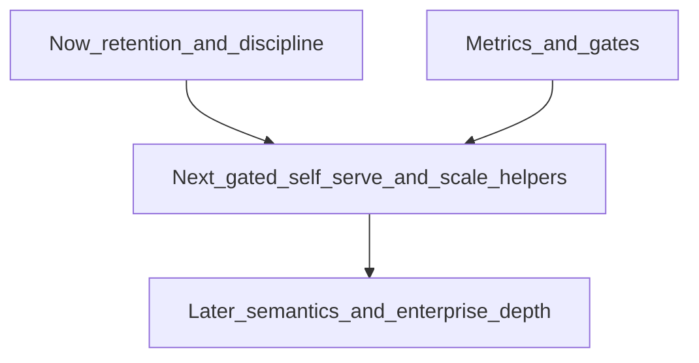

# Post-pilot growth roadmap (disciplined)

**Goal:** Improve **retention**, cut **support burden**, make **branch rollout safer**, increase **manager-visible value**, and open **controlled upsell**—without scope creep into marketplace, consumer mobile, giant ERP, full loyalty, heavy accounting, or vanity AI.

**Relationship to other docs:** This is the **time-horizon** view (now / next / later / reject). Phased workstreams remain in [POST_PILOT_ROADMAP.md](./POST_PILOT_ROADMAP.md); strategic order and maps in [STRATEGIC_MAPS_AND_ORDER.md](./STRATEGIC_MAPS_AND_ORDER.md); packaging in [PRODUCT_PACKAGING_MODEL.md](./PRODUCT_PACKAGING_MODEL.md); expansion limits in [EXPANSION_GUARDRAILS.md](./EXPANSION_GUARDRAILS.md).

---

## 1. Recommended roadmap

### Now (0–2 quarters) — highest value / lowest regret

| Theme | What | Engineering | Ops / support | Commercial upside |
|-------|------|-------------|---------------|-------------------|
| **Retention: “it works on day two”** | Harden onboarding truth: `readyForGoLive`, config visibility, QR/session education, guardrails on self-serve paths already shipped or in flight | Maintain permission map, audit, caps; avoid new surfaces without gates | Fewer “QR broken / wrong login” tickets; runbooks stay canonical | Fewer refunds/churn from failed pilot→paid |
| **Safer branch expansion** | Enforce [BRANCH_ROLLOUT_MODEL.md](./BRANCH_ROLLOUT_MODEL.md): one branch steady before next; headroom from support summary; no silent slug/URL changes | Provision + limits unchanged; optional small UX for owner visibility of limits | CS uses one playbook; fewer parallel broken rollouts | Upsell **growth** when second site is real, not accidental |
| **Support efficiency** | Guarded scripts ([support-guarded-patch.mjs](../../deploy/scripts/support-guarded-patch.mjs)), support read/write keys, audit tail; reduce raw Swagger for common PATCHes | Low code; high discipline | Same FTE handles more tenants | Time for CS to sell services / expansions |
| **Manager-visible value (no new modules)** | Clear tenant rollup + branch daily semantics in UI copy; weekly digest / reports trusted definitions | Prefer **copy and cues** from existing payloads before new aggregates | Less “numbers don’t match” dispute time | Trust → renewal; growth tier justified by multi-site use |
| **Controlled upsell** | Single packaging story [PRODUCT_PACKAGING_MODEL.md](./PRODUCT_PACKAGING_MODEL.md); AI only where `PlanFeatures` + opt-in already allow | No new billing automation required to **define** tiers | Sales deck matches API behavior | Cleaner **starter → growth** path |

**Brutal reality:** “Now” is mostly **discipline + clarity + a thin layer of product**—not a feature explosion.

---

### Next (2–4 quarters) — after gates and metrics justify cost

| Theme | What | Engineering | Ops / support | Commercial upside |
|-------|------|-------------|---------------|-------------------|
| **Identity at scale** | Self-serve invites for non-owner roles **only if** [INCREMENTAL_PRODUCT_GATES.md](./INCREMENTAL_PRODUCT_GATES.md) invite gate clears | Auth, rate limits, audit, deliverability risk | Trade ticket type: fewer shared-login incidents vs invite/password-reset noise | Seats within plan; fewer emergency support adds |
| **Menu at scale** | Import/apply improvements, maybe CSV—**only if** 80+ items or second-branch trigger per [RETENTION_BACKLOG.md](./RETENTION_BACKLOG.md) | Validation, caps, dry-run, recovery story | Support handles fewer manual catalog fires | Faster time-to-value on growth deals |
| **Branch catalog parity** | Support-only menu clone when pain justifies [SUPPORT_ONLY_MENU_CLONE_SPEC.md](./SUPPORT_ONLY_MENU_CLONE_SPEC.md) | Transactional clone; no self-serve “sync” | Predictable CS procedure vs bespoke DB work | Multi-site deals close faster |
| **Health and CS cadence** | Operationalize [CUSTOMER_HEALTH_SIGNALS.md](./CUSTOMER_HEALTH_SIGNALS.md) + weekly review | Mostly reporting/queries + dashboards or exports | Proactive outreach; less surprise churn | Services upsell (training) when red |
| **Reporting polish** | Operator “focus” cues from **existing** daily/weekly payloads (discount share, cancellations, stock flags)—not a new reporting engine | Small, branch-scoped UI + API fields if needed | Managers act without calling support | Perceived depth without ERP |

**Dependency:** “Next” items assume **Now** stabilized metrics (ticket themes, rollout compliance, plan field accuracy)—otherwise you build on sand.

---

### Later (4+ quarters) — only with proven multi-TZ / multi-site pain

| Theme | What | Why wait |
|-------|------|----------|
| **Tenant rollup local-day parity** | Same-local-day semantics for cross-branch compare at tenant level | High eng + QA + CS education cost; gate in [INCREMENTAL_PRODUCT_GATES.md](./INCREMENTAL_PRODUCT_GATES.md) |
| **Deeper site-scoped RBAC** | Stricter “this login only these branches” | Product + enterprise sales pull; avoid until multiple multi-franchise deals |
| **Billing automation** | Stripe (or equivalent) fully wired to `SubscriptionPlan` | Justify with MRR and finance ownership—not “because SaaS should” |
| **More AI surfaces** | Only `PlanFeatures` already reserved + clear ROI (e.g. promotion ideas when offers stable) | Cost, trust, and support triage load |

---

### Explicitly rejected / deferred (not on roadmap)

| Item | Reason |
|------|--------|
| **Marketplace / third-party ordering aggregation** | Scope and liability explosion; not core monolith bet. |
| **Customer consumer mobile app** | Out of scope per [POST_PILOT_STAKEHOLDER_ALIGNMENT.md](./POST_PILOT_STAKEHOLDER_ALIGNMENT.md); web guest flow is the product. |
| **Giant ERP (full COGS, procurement, multi-entity GL)** | Breaks narrow SKU; support and eng become consulting. |
| **Full loyalty suite** (points economy, coalition, marketing automation) | Ops complexity; separate category of company. |
| **Heavy accounting** (statutory books, tax engine beyond documented basics) | Same as ERP. |
| **Vanity AI** (chatbot for guests, unconstrained generation, “AI replaces manager”) | Reputation, cost, and support risk; contradicts advisory-only positioning in [PLAN_AND_AI_UPSELL.md](./PLAN_AND_AI_UPSELL.md). |
| **Per-customer product forks** | Unmaintainable; “custom” = limits + services + contract only ([EXPANSION_GUARDRAILS.md](./EXPANSION_GUARDRAILS.md)). |

---

## 2. Priorities and dependencies

**Value vs risk (highest priority first):**

1. **Onboarding + URL + branch discipline** — reduces churn and incidents; low feature risk if you don’t overscope.
2. **Support tooling + runbook adherence** — unlocks scale without headcount.
3. **Reporting trust (definitions + UI)** — retention and upsell readiness for growth tier.
4. **Gated self-serve (invites, import)** — only after metrics justify ([INCREMENTAL_PRODUCT_GATES.md](./INCREMENTAL_PRODUCT_GATES.md)).
5. **Reporting semantics upgrades (local-day rollup)** — last among “big” items; depends on proven pain.

**Hard dependencies:**

- **Invites / import:** Revenue or pilot volume + measured support pain ([INCREMENTAL_PRODUCT_GATES.md](./INCREMENTAL_PRODUCT_GATES.md)).
- **Menu clone:** Multi-branch catalog pain + CS agreement ([SUPPORT_ONLY_MENU_CLONE_SPEC.md](./SUPPORT_ONLY_MENU_CLONE_SPEC.md)).
- **Local-day rollup parity:** Documented confusion + product+CS signoff ([INCREMENTAL_PRODUCT_GATES.md](./INCREMENTAL_PRODUCT_GATES.md)).
- **Growth upsell:** Packaging + stable operations story ([PRODUCT_PACKAGING_MODEL.md](./PRODUCT_PACKAGING_MODEL.md)).

---

## 3. What must wait

- **Full billing automation** until recurring revenue and finance process justify implementation cost.
- **Local-day tenant rollup** until multi-timezone disputes are frequent enough to fund the build + ongoing explanation burden.
- **Net-new large modules** (loyalty, ERP-shaped) until core retention and branch discipline are boringly green in metrics.
- **AI expansion beyond current flags** until LLM cost/support ratios are acceptable and features are not “vanity.”

---

## 4. What should be rejected (ongoing)

Requests that:

- Require **tenant-specific core behavior** or silent writes without audit.
- **Bypass** support keys for limits, commerce, or destructive ops.
- Position the product as **replacement accounting / ERP** without contract and staffing.
- Add **consumer app** or **marketplace** scope without a deliberate company bet change.
- Add **AI** that makes autonomous operational or financial decisions.

Escalation path: [EXPANSION_GUARDRAILS.md](./EXPANSION_GUARDRAILS.md) § product-ruthless rule.

---

## 5. Success criteria by phase

### Now — success looks like

| Metric / signal | Target direction |
|-----------------|------------------|
| Pilot → paid conversion / early churn | Stable or improving; reasons documented |
| Top support themes (QR, permissions, rollout) | Not growing as % of tickets ([EXPANSION_GUARDRAILS.md](./EXPANSION_GUARDRAILS.md) thresholds) |
| Branch adds without `branchRollouts` discipline | **Zero** net new violations (process) |
| Manager trust | Fewer “numbers wrong” disputes where semantics are documented |
| Commercial hygiene | `subscriptionPlan` and limits match contract for paying accounts |

### Next — success looks like

| Metric / signal | Target direction |
|-----------------|------------------|
| Invite/import volume | Used where gated; error and abuse rates bounded |
| CS time per new branch | Down vs baseline (clone + playbook) |
| Growth tier attach | Correlates with real multi-branch + API need |
| Health signals | Used in weekly CS review; at-risk accounts contacted |

### Later — success looks like

| Metric / signal | Target direction |
|-----------------|------------------|
| Local-day / rollup work | Shipped **only if** pre-gate business case passed |
| Enterprise deals | Served with **contract + overrides**, not forks |
| Infra spend | Grows with revenue and SLO evidence, not heroics |

---

## Review cadence

Align with [EXPANSION_GUARDRAILS.md](./EXPANSION_GUARDRAILS.md): weekly CS themes, monthly gate review, quarterly packaging and capacity. Refresh [GROWTH_READINESS_REPORT.md](./GROWTH_READINESS_REPORT.md) after each commercial wave.

## Related

- [POST_PILOT_ROADMAP.md](./POST_PILOT_ROADMAP.md) — phased workstreams
- [POST_PILOT_GROWTH_INDEX.md](./POST_PILOT_GROWTH_INDEX.md) — index
- [RETENTION_BACKLOG.md](./RETENTION_BACKLOG.md) — ranked backlog and policy triggers
