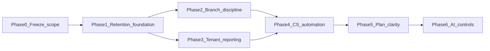

# Post-pilot roadmap (phased)

Maps the eight growth workstreams to **phases** with dependencies. Guardrails: **modular monolith**, no customer mobile apps, no marketplace/delivery/ERP expansion, no AI gimmicks.

## Phase 0 — Scope freeze (complete)

- Stakeholder alignment doc: [POST_PILOT_STAKEHOLDER_ALIGNMENT.md](./POST_PILOT_STAKEHOLDER_ALIGNMENT.md)
- Risk and backlog baselines: [RETENTION_BACKLOG.md](./RETENTION_BACKLOG.md)

## Phase 1 — Retention foundation

**Outcomes:** Fewer churn drivers from identity and configuration.

- Prioritize **support-only member API** vs full invites ([RETENTION_BACKLOG.md](./RETENTION_BACKLOG.md)).
- Harden **`APP_PUBLIC_URL`** / QR runbooks and onboarding warnings.
- Gate **menu import** on volume triggers — do not premature optimize.

## Phase 2 — Branch discipline

**Outcomes:** Expansion without support chaos.

- Adopt [BRANCH_ROLLOUT_MODEL.md](./BRANCH_ROLLOUT_MODEL.md); use `Tenant.metadata.branchRollouts`.
- Enforce plan limits via existing commerce + support playbooks ([COMMERCIAL_LIFECYCLE.md](../operations/COMMERCIAL_LIFECYCLE.md)).

## Phase 3 — Practical reporting depth

**Outcomes:** Multi-site owners see trustworthy aggregates.

- **Shipped:** Read-only **tenant rollup** API (`GET /api/v1/tenants/reports/tenant-rollup`) with `reports.tenant_rollups` permission — see [MULTIBRANCH_READ_PILOT.md](../phase2/MULTIBRANCH_READ_PILOT.md).
- **Semantics:** UTC inclusive date range (documented in API response); differs from per-branch local “day” reports when timezones are mixed — future Phase-2.1 can add local-day parity.

## Phase 4 — Customer success visibility

**Outcomes:** Earlier at-risk detection.

- Implement cadence using [CUSTOMER_HEALTH_SIGNALS.md](./CUSTOMER_HEALTH_SIGNALS.md).
- Optional: extend weekly snapshot outputs with suggested health lines.

## Phase 5 — Plan / package clarity

**Outcomes:** Sales and CS speak one language on tiers.

- [PLAN_AND_AI_UPSELL.md](./PLAN_AND_AI_UPSELL.md) as single reference; align internal console copy where relevant.

## Phase 6 — Controlled AI upsell

**Outcomes:** Revenue from insights without reliability bait-and-switch.

- Keep opt-in LLM path; add operational caps and plan positioning per [PLAN_AND_AI_UPSELL.md](./PLAN_AND_AI_UPSELL.md).

## Phase 7 — Ongoing operational scale

**Outcomes:** Same architecture, repeatable ops.

- Release gate, backups, Redis/Socket.IO discipline unchanged ([PILOT_RELEASE_GATE.md](../operations/PILOT_RELEASE_GATE.md)).
- No microservices; observability and support tooling stay the backbone ([OBSERVABILITY.md](../operations/OBSERVABILITY.md)).

## Step-to-phase map (original eight-step package)

| Step | Phase |
|------|--------|
| 1 Analyze post-pilot gaps | Phase 0 |
| 2 Retention / expansion priorities | Phase 0–1 |
| 3 Safe branch rollout model | Phase 2 |
| 4 Deepen practical reporting | Phase 3 |
| 5 Customer success / health signals | Phase 4 |
| 6 Plan/package growth paths | Phase 5 |
| 7 Controlled AI-assisted value | Phase 6 |
| 8 Final post-pilot roadmap | This document |
