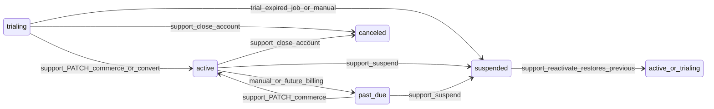

# Commercial lifecycle and paid pilots

**Enforcement source of truth:** `Tenant.billingStatus`, `Tenant.trialEndsAt`, and plan limits in [`apps/api/src/commerce/plan-limits.config.ts`](../../apps/api/src/commerce/plan-limits.config.ts). Customer success “phase” (e.g. pilot) is **metadata** (see [PILOT_METADATA_SCHEMA.md](./PILOT_METADATA_SCHEMA.md)) — not a second billing state machine.

## Lifecycle concepts

| Concept | Meaning |
|--------|---------|
| **Trial** | `billingStatus === trialing`, usually with `subscriptionPlan === trial` and `trialEndsAt` set. Expired trials are blocked for staff and guests unless support changes status. |
| **Pilot (paid)** | **Not** a separate DB enum. Set `billingStatus: active` (or `trialing` if still in a time-boxed pilot), `subscriptionPlan` per contract, and `metadata.commercialEngagement: "pilot"`. |
| **Active (paid)** | `billingStatus === active`, trial not expired (if still trialing). |
| **Suspended** | `billingStatus === suspended` — blocks staff login, JWT, and public guest flows. Reasons are stored in tenant metadata and audit (`support.suspend`). |
| **Closed** | `billingStatus === canceled` — terminal; same blocking as suspended for access. Treat “closed” in runbooks as **canceled**. |

## State transitions (billing)

**Trial expiry job:** `POST /api/v1/support/jobs/expire-trials` sets `trialing` → `suspended` when `trialEndsAt` is in the past, and writes `metadata.trialExpiredAt` (see [DEMO_AND_PILOT_ENVIRONMENT.md](./DEMO_AND_PILOT_ENVIRONMENT.md) for scheduling). Operator checklist: [COMMERCIAL_ROLLOUT.md](./COMMERCIAL_ROLLOUT.md).

## Support playbook (early paid pilots)

1. **New paid pilot:** `PATCH /support/tenants/:id/commerce` — set `subscriptionPlan`, `billingStatus: active`, `maxBranches` / `maxUsers` overrides as needed; `PATCH .../metadata` with `commercialEngagement: "pilot"`, `csOwner`, `pilotNotes`, `pilotPhase` as needed.
2. **Pause pilot (non-payment):** `POST .../suspend` with `reasonCode: customer_request` (or `other`) and optional `note`.
3. **Payment issue:** suspend with `reasonCode: payment`; document in `note`.
4. **Resume:** `POST .../reactivate` — restores `billingStatus` from `metadata.previousBillingStatus` when present (e.g. returns a valid trialing tenant to `trialing` if the trial is still in date).
5. **End relationship:** `PATCH .../commerce` with `billingStatus: canceled` (closed account).

**Copy-paste curl examples** for pilots: [PILOT_COMMERCIAL_SETUP.md](./PILOT_COMMERCIAL_SETUP.md).

## Explainability

API responses use stable machine codes (`TENANT_SUSPENDED`, `TENANT_TRIAL_EXPIRED`, etc.). Staff `GET /tenants/commerce` includes an `access` object. Support `GET .../summary` includes effective limits and access details so operators see **why** a tenant is limited without guessing.
