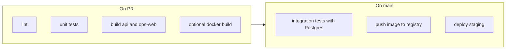

# Deployment and DevOps hardening — RestoCafe OS

Assumes VPS or customer-controlled cloud (single or small cluster), not serverless-only.

**Paid pilot go / no-go:** use [`PILOT_RELEASE_GATE.md`](./PILOT_RELEASE_GATE.md) as the canonical strict gate (blocking criteria, pre-pilot, day-of-cutover, rollback, week-1 monitoring). Day-of smoke: [`deploy/scripts/pilot-environment-smoke.sh`](../../deploy/scripts/pilot-environment-smoke.sh) (`npm run pilot:env-smoke`).

**Demo vs pilot environments:** sales demos and paid pilots use **different stacks** (separate databases) and different runbooks. Demos may use `metadata.demo` + `reset-demo` for quick transactional wipes; pilots follow the release gate and must not be tagged as demo. See [`DEMO_AND_PILOT_ENVIRONMENT.md`](./DEMO_AND_PILOT_ENVIRONMENT.md).

## 1. Infrastructure risk map

| Area | Risk | Mitigation |
|------|------|------------|
| **Secrets in git** | High | `.env` gitignored; use env files only on host or secret manager ([`secrets-management.md`](./secrets-management.md)) |
| **Docker Compose defaults** | Medium | [`docker-compose.yml`](../../docker-compose.yml) uses weak dev passwords; never use as-is in production |
| **JWT / DB exposure** | High | Strong `JWT_*`, Postgres auth, firewall DB port 5432 to app only |
| **TLS termination** | High | Reverse proxy (Caddy/Nginx) with certs; `TRUST_PROXY=true` on API |
| **Migration drift** | High | CI and local verification use `prisma migrate deploy`; prod one job before new containers scale |
| **Single API process** | Medium | Node cluster mode not built-in; scale **replicas** behind LB; **one** migrator |
| **Static assets** | Low | Ops web is SPA: build to `dist/`, serve via nginx/Caddy; `VITE_*` baked at build time; long-session / React Query + Socket.IO behavior: [`ops-web-performance-audit.md`](./ops-web-performance-audit.md) |
| **Redis** | High (all production) | Production startup is now **fail-closed** for close-bill idempotency: set **`REDIS_URL`** on every API replica and keep **`IDEMPOTENCY_REQUIRE_REDIS=true`**. [`deploy/docker-compose.stack.yml`](../../deploy/docker-compose.stack.yml) defaults this flag to true. Prefer a managed Redis or HA setup for production; idempotency locks are short-lived (90s TTL) but outages still block keyed close-bill until Redis recovers. |
| **Cron** | Low | Audit retention + support `expireDueTrials` use a **Redis leader lock** when `REDIS_URL` is set (`LeaderLockService`) so only one replica runs the job; without Redis, behavior matches single-process (each replica may run timers—acceptable for dev only). |
| **Logs** | Medium | Ship stdout to journald/Docker logging driver or agent; persist per retention policy |
| **Backups** | High | Automate Postgres dumps + test restore quarterly |
| **DB connection pool** | Medium | `DATABASE_URL` `connection_limit` × API replicas must fit Postgres `max_connections` — [§2c](#2c-database-connection-pool-sizing) |

## 2. Deployment checklist

- [ ] Linux host with Docker (or k8s) and firewall (only 80/443 public).
- [ ] Postgres 15+ (managed or container) with **encrypted** volume.
- [ ] Secrets injected at runtime (env file 0600, systemd `EnvironmentFile`, or cloud secrets).
- [ ] `DATABASE_URL`, `JWT_ACCESS_SECRET`, `JWT_REFRESH_SECRET`, `CORS_ORIGIN` set; `NODE_ENV=production`.
- [ ] **`REDIS_URL`** for every production API environment.
- [ ] **`IDEMPOTENCY_REQUIRE_REDIS=true`** in every production API environment.
- [ ] `TRUST_PROXY=true` if behind reverse proxy.
- [ ] Build images from locked lockfile: `docker build -f apps/api/Dockerfile .` from repo root.
- [ ] Run **`prisma migrate deploy`** once per release (init container or CI job), then roll out API.
- [ ] Build ops-web with production `VITE_API_URL` pointing at public API URL.
- [ ] Serve SPA static files + proxy `/api` to API (see [`deploy/nginx/restocafe.conf.example`](../../deploy/nginx/restocafe.conf.example)).
- [ ] TLS certificates (Let’s Encrypt or provider).
- [ ] Health checks: LB hits `/api/v1/health/ready` (readiness) and `/api/v1/health/live` (liveness). Readiness returns `200` for `healthy` or `degraded`, and `503` for `not_ready`.

## 2b. Second API replica and Socket.IO (rollout)

**Do not** add a second live API instance if branch realtime matters unless **`REDIS_URL`** is set on **all** replicas (shared Socket.IO adapter + optional idempotency). Sticky sessions alone do not fix cross-node broadcasts—see [`socket-io-scaling.md`](./socket-io-scaling.md).

**Safe order**

1. Redis reachable from every API pod; same `REDIS_URL` string everywhere.
2. Deploy or enable `REDIS_URL` on the **first** replica; verify ops-web realtime (single user).
3. Register the **second** replica in the load balancer pool; verify readiness on both.
4. Run [`staging-socket-io-checklist.md`](./staging-socket-io-checklist.md) (two browsers, same branch).

If Redis is unavailable while `REDIS_URL` is configured, API startup may fail at `connectToRedis`. Production now also fails startup before serving traffic if Redis-backed idempotency is unavailable, and `/health/ready` reports `not_ready` with Redis detail. Treat Redis as a hard dependency for production realtime and payment idempotency.

## 2c. Database connection pool sizing

Prisma opens a **connection pool per API process** (see [Prisma connection management](https://www.prisma.io/docs/orm/prisma-client/setup-and-configuration/databases-connections)). Each horizontal replica multiplies open connections to Postgres.

**Rule of thumb:** keep `(connection_limit per replica × number of API replicas) + connections for migrations, cron, and admin tools` below roughly **70%** of the database `max_connections`. Leave headroom for spikes and monitoring.

**Configure:** add `connection_limit` (and other pool params if needed) to `DATABASE_URL` query string, e.g. `postgresql://…/db?schema=public&connection_limit=10`. Tune per environment after measuring; smaller pools with more replicas may still exhaust Postgres if the product of replicas × limit is too high.

**PgBouncer / transaction pooling:** if you use an external pooler, align Prisma’s pool size and pooler `default_pool_size` with the pooler mode (session vs transaction). Misconfiguration causes confusing connection errors under load.

**Monitor:** track active connections and slow queries (`pg_stat_activity`, managed-DB metrics). See also [`analytics-events-retention.md`](./analytics-events-retention.md) for long-term table growth.

## 2d. Redis client connections per API pod

With `REDIS_URL` set, expect **about seven** Redis TCP connections **per API process**: two for the Socket.IO `redis` pub/sub adapter, and five `ioredis` clients (idempotency, staff auth cache, reports daily cache, leader lock, branch menu cache invalidation). Budget `7 × replicas` against Redis `maxclients` and provider limits. Optional future work: consolidate multiple `ioredis` instances into one shared client to cut connection count—see [`redis-cache-and-queues.md`](./redis-cache-and-queues.md).

**Background jobs:** there is no server-side BullMQ queue today; defer worker infrastructure until load metrics justify it—same doc.

## 3. Release checklist

- [ ] All tests green: `npm run ci` locally or in CI.
- [ ] Changelog / version tag (`APP_VERSION`, `GIT_SHA` in deploy env).
- [ ] DB migrations reviewed (destructive ops flagged).
- [ ] Staging deploy + smoke (login, order flow).
- [ ] Maintenance window communicated if breaking DB change.
- [ ] Run **`npm run db:migrate:deploy -w api`** (or image entrypoint once) **before** or as first step of rollout.
- [ ] Deploy new API image; verify metrics and error logs.
- [ ] Deploy new static assets if frontend changed (cache-bust).

## 4. Rollback checklist

- [ ] **Application**: redeploy previous container image tag (keep last N tags in registry).
- [ ] **Database**: new migrations may be **irreversible** — restore from backup if backward-incompatible (rare); prefer additive migrations.
- [ ] **Config**: revert env changes (CORS, secrets) in same deploy artifact as last good.
- [ ] **Frontend**: redeploy previous `ops-web` `dist/` or previous image if containerized.

## 5. Backup / restore checklist

**Backup**

- [ ] Nightly `pg_dump` (or provider snapshots) with retention (e.g. 7d daily, 4 weekly).
- [ ] Store off-box (S3-compatible, another region).
- [ ] Encrypt at rest; restrict access IAM-style or ACLs.
- [ ] Optional: backup MinIO/S3 bucket if storing uploads.

**Restore testing (quarterly)**

- [ ] Follow [`staging-restore-drill-checklist.md`](./staging-restore-drill-checklist.md): restore dump to **staging** DB; `npm run db:migrate:deploy`; health + optional [`restore-drill-smoke.sh`](../../deploy/scripts/restore-drill-smoke.sh).
- [ ] Document RTO/RPO and actual restore duration on the checklist.

## 6. Recommended CI/CD pipeline

- **PR**: install from lockfile → `db:generate` → build → lint → test → `npm audit --audit-level=critical` → optional `docker build` to validate Dockerfile.
- **Main**: same + integration job with `prisma db push`/`migrate deploy` + seed + integration tests.
- **Release**: tag → build & push `:vX.Y.Z` and `:latest` → deploy staging → manual approval → production with **migrate job** then **rolling replace** API containers.

GitHub Actions: see [`.github/workflows/ci.yml`](../../.github/workflows/ci.yml). Extend with `workflow_dispatch` deploy and registry push when ready.

## 7. Ops hardening tasks (prioritized)

1. **Done in repo**: Monorepo-aware API Dockerfile, `.dockerignore`, production compose sample, nginx example, `TRUST_PROXY` docs, CI Docker build verification.
2. **Short term**: Pin image digests in compose; add log driver config; WAF/rate limits at edge.
3. **Medium term**: Move secrets to vault; separate migrate Job in k8s.
4. **Long term**: Multi-region, automated restore drills, SLO dashboards.

See also: [`OBSERVABILITY.md`](./OBSERVABILITY.md), [`MIGRATIONS.md`](../database/MIGRATIONS.md).
