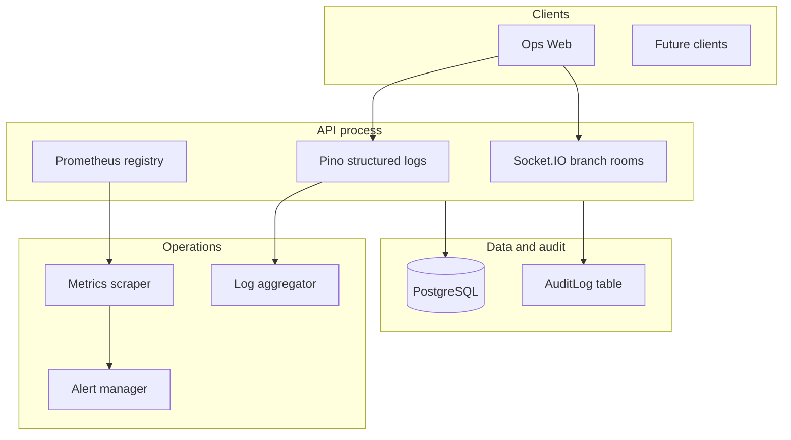

# Observability and incident readiness — RestoCafe OS

## 1. Observability architecture

- **Logs**: JSON-friendly lines via `nestjs-pino` / `pino-http`. Each line includes `requestId`, and when the JWT + branch guard have run, `tenantId`, `userId`, and `branchId`. Sensitive headers are **redacted** (`authorization`, `cookie`, `x-support-api-key`).
- **Correlation**: Single owner for `x-request-id` — Pino `genReqId` assigns `req.requestId` and echoes the header ([`request-id.ts`](../../apps/api/src/common/http/request-id.ts)).
- **Metrics**: Prometheus text at `GET /api/v1/internal/metrics` when `METRICS_ENABLED=true` ([`prometheus.ts`](../../apps/api/src/common/metrics/prometheus.ts)). Default Node metrics + HTTP histogram/counter + business + WebSocket counters.
- **Exceptions**: [`GlobalExceptionFilter`](../../apps/api/src/common/http/http-exception.filter.ts) logs structured `http_exception` / `unhandled_exception` and increments counters.
- **Health**: Liveness and readiness under `/api/v1/health/*`. Readiness now reports dependency-level status for **Postgres** and **Redis**, with explicit `healthy`, `degraded`, and `not_ready` states.
- **Support diagnostics**: `GET /api/v1/support/diagnostics` with `x-support-api-key` — process metadata plus the same DB/Redis operational snapshot, with no tenant PII.

## 2. Logging standards

| Field | Meaning |
|-------|---------|
| `svc` | Always `restocafe-api` on structured exception lines |
| `msg` | `http_exception`, `unhandled_exception`, `slow_request`, `ws_connected`, `ws_disconnected`, `audit_retention_prune`, `ai_insights_daily_summary` (AI insights eligibility/outcome; see §2.1) |
| `requestId` | Same as `x-request-id` response header |
| `tenantId` / `userId` / `branchId` | Present after auth + branch guard on HTTP logs |
| `level` | Pino: `LOG_LEVEL` env (default `info` in production, `debug` in dev) |

**Do not** log passwords, refresh tokens, or full payment PANs. Audit trail for business actions remains in the `AuditLog` table via [`AuditService`](../../apps/api/src/modules/audit/audit.service.ts).

**Slow requests**: `SlowRequestInterceptor` logs `slow_request` when duration exceeds `SLOW_REQUEST_MS` (default **2000** ms).

### 2.1 AI insights log aggregation (`msg: ai_insights_daily_summary`)

The AI insights module emits **one JSON object per request** via Nest `Logger` (stringified), with `msg` always `ai_insights_daily_summary`. Use these lines to aggregate **plan gating**, **opt-in**, **rate caps**, and **successful completions** without adding Prometheus labels per tenant.

| Field (typical) | Meaning |
|-----------------|--------|
| `tenantId`, `branchId` | Scope |
| `available` | `true` only when the LLM returned a parsed summary |
| `reason` | When `available: false`: `plan_not_eligible`, `tenant_opt_in_required`, `cap_exceeded` (see [PLAN_AND_AI_UPSELL.md](../growth/PLAN_AND_AI_UPSELL.md)) |
| `plan` | Present when `reason` is `plan_not_eligible` |
| `maxPerDay`, `used`, `capKey` | Present when `reason` is `cap_exceeded` |
| `date`, `model` | Present on successful `available: true` |

**Example queries (adapt to your log stack):**

- **Count block reasons (24h):** filter `msg = "ai_insights_daily_summary"` and `available = false`, group by `reason`.
- **Spike in `plan_not_eligible` on paying tenants:** correlate with `subscriptionPlan` on tenant — often metadata opt-in before commerce upgrade; fix sales/commerce alignment, not the LLM ([PLAN_AND_AI_UPSELL.md](../growth/PLAN_AND_AI_UPSELL.md)).
- **Spike in `cap_exceeded`:** tune `LLM_INSIGHTS_MAX_PER_BRANCH_PER_DAY` or set customer expectations before raising caps.

**Privacy:** Log lines do **not** include report snapshots or PII; snapshot content stays in the API response path only.

## 3. Metrics to track

| Metric | Type | Use |
|--------|------|-----|
| `process_*` | default | CPU, memory, event loop (Node default metrics) |
| `http_requests_total` | Counter | RPS by `method`, `route`, `status` |
| `http_request_duration_seconds` | Histogram | Latency SLOs, percentiles |
| `http_exceptions_total` | Counter | Handled `HttpException` by `status_class`, exception `code` (class name) |
| `http_unhandled_errors_total` | Counter | Non-HTTP exceptions (500 path) |
| `restocafe_business_events_total` | Counter | `event` ∈ `order_paid`, `order_cancelled`, `audit_log_write`, `audit_retention_prune`, … |
| `websocket_authenticated_connections` | Gauge | Live WS clients after JWT |
| `websocket_branch_events_emitted_total` | Counter | Realtime fan-out by `event` name |

**Cardinality**: Avoid adding raw `branchId` or `tenantId` as Prometheus labels in hot paths; use logs for per-tenant forensics.

## 4. Alerts to configure (suggested)

| Alert | Condition | Severity |
|-------|-----------|----------|
| High 5xx rate | `rate(http_requests_total{status=~"5.."}[5m])` above threshold | Critical |
| Unhandled errors | `increase(http_unhandled_errors_total[5m]) > 0` | Critical |
| Readiness `not_ready` | Probe on `/api/v1/health/ready` non-200 | Critical |
| Readiness `degraded` | Probe on `/api/v1/health/ready` returns 200 with `status=degraded` | Warning |
| Liveness failing | `/api/v1/health/live` non-200 | Page |
| Slow tail latency | histogram `http_request_duration_seconds` p99 | Warning |
| Business drop | `rate(restocafe_business_events_total{event="order_paid"}[1h])` near zero during service hours | Warning |
| WebSocket stuck | `websocket_authenticated_connections` flatline vs expected | Info |

Tune thresholds to your traffic profile.

## 5. Incident triage playbook

Customer-facing correlation ids and first-line steps: [SUPPORT_INCIDENT_TRIAGE.md](./SUPPORT_INCIDENT_TRIAGE.md). Pilot **workflow, diagnostics matrix, severity, and templates:** [SUPPORT_DIAGNOSTICS_WORKFLOW.md](./SUPPORT_DIAGNOSTICS_WORKFLOW.md).

1. **Confirm blast radius**: one branch vs all tenants (check logs for `tenantId` pattern, support tools).
2. **Health**: `GET /api/v1/health/live` then `/ready`. Treat `status=not_ready` as a hard outage. Treat `status=degraded` as an active Redis/cross-replica risk that still needs operator action.
3. **Logs**: Filter by `requestId` from user report or `x-request-id` from browser devtools; search `unhandled_exception` or `http_exception` with `status` ≥ 500.
4. **Metrics**: Grafana/Prometheus — spike in `http_unhandled_errors_total`, latency histogram, `restocafe_business_events_total` for `order_paid`.
5. **WebSocket**: If UI stale, check `websocket_authenticated_connections` and client errors; verify JWT expiry and CORS.
6. **Audit**: For disputed payments, query `AuditLog` for `order.paid` and related `entityId`.
7. **Rollback**: Redeploy previous image; DB migrations are separate (see [`MIGRATIONS.md`](../database/MIGRATIONS.md)).

## 6. Production diagnostics checklist

- [ ] `METRICS_ENABLED=true` and scraper scraping `/api/v1/internal/metrics` (internal network only).
- [ ] `LOG_LEVEL=info` (or `warn` at scale); logs shipped off-node.
- [ ] `APP_VERSION` / `GIT_SHA` set in deploy manifest for traceability (surfaced on `/health/*` and support diagnostics).
- [ ] `SUPPORT_API_KEY` set and stored in secrets manager; diagnostics route tested monthly.
- [ ] Kubernetes: liveness `live`, readiness `ready`, startup probe if using slow cold start. Readiness alerts must trigger on `503`, and operators should inspect `status=degraded` responses before scaling or rollout.
- [ ] Alerts wired to on-call rotation.
- [ ] Runbook link in alert annotations (this doc + triage section). Example rules: [`deploy/observability/pilot-alerts.example.yaml`](../../deploy/observability/pilot-alerts.example.yaml) (tune `job` / thresholds; point `runbook` URLs at your repo).
- [ ] Pilot ops index for cross-links: [`PILOT_OPERATIONS_INDEX.md`](./PILOT_OPERATIONS_INDEX.md).

### Environment variables

| Variable | Purpose |
|----------|---------|
| `LOG_LEVEL` | Pino level (`info`, `debug`, …) |
| `SLOW_REQUEST_MS` | Threshold for `slow_request` logs (default 2000) |
| `METRICS_ENABLED` | Expose Prometheus and HTTP/business metrics |
| `APP_VERSION` | Human build id (optional) |
| `GIT_SHA` | Git commit (optional) |
| `SUPPORT_API_KEY` | Legacy single key for all support routes, or omit when using read+write pair |
| `SUPPORT_API_KEY_READ` | With `SUPPORT_API_KEY_WRITE`, split keys (GET vs POST/PATCH); see [SUPPORT_TOOLING.md](./SUPPORT_TOOLING.md) |
| `SUPPORT_API_KEY_WRITE` | Mutating support routes only when split |
