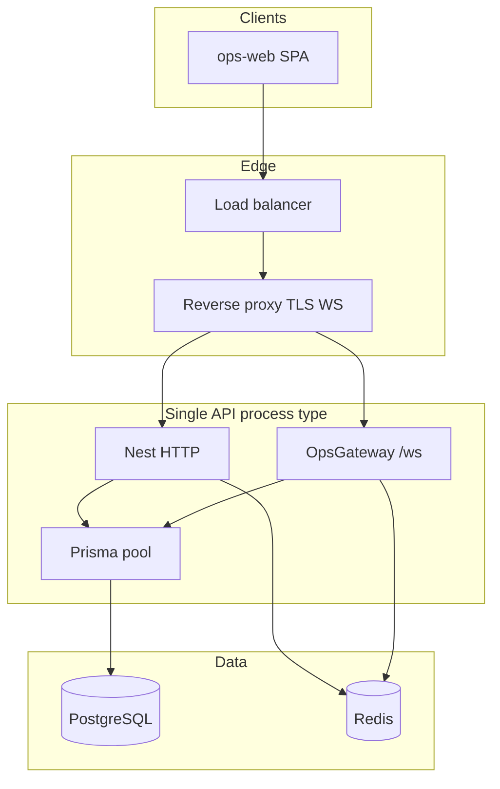

# Scale Readiness + Heavy Load Audit — RestoCafe OS

**Audience:** Principal performance / scalability / backend / frontend / DB / production review.  
**Scope:** Codebase and ops docs as of audit date. **No new product features**; **modular monolith preserved** unless evidence forces a different conclusion.

---

## 0. Executive summary — current scale readiness

### What is already credible for narrow paid pilots

| Area | Evidence |
|------|----------|
| **Modular monolith boundaries** | Feature modules (`orders`, `kitchen`, `reports`, `ai-insights`, `support`, `commerce`, etc.) with Nest imports; hot paths are explicit services. |
| **Health / ops probes** | `GET /api/v1/health/live` (no DB), `GET /api/v1/health/ready` (`SELECT 1`); health is `@SkipThrottle()` — [`apps/api/src/health.controller.ts`](../../apps/api/src/health.controller.ts). |
| **Rate limiting baseline** | Global `ThrottlerModule`: 120 requests / 60s; AI insights controller overrides to **15/min** — [`apps/api/src/app.module.ts`](../../apps/api/src/app.module.ts), [`apps/api/src/modules/ai-insights/ai-insights.controller.ts`](../../apps/api/src/modules/ai-insights/ai-insights.controller.ts). |
| **Slow request visibility** | `SlowRequestInterceptor` logs `slow_request` when duration exceeds `SLOW_REQUEST_MS` (default 2000) — [`apps/api/src/common/observability/slow-request.interceptor.ts`](../../apps/api/src/common/observability/slow-request.interceptor.ts). |
| **Optional HTTP metrics** | `HttpMetricsInterceptor` when `METRICS_ENABLED=true` — [`apps/api/src/app.module.ts`](../../apps/api/src/app.module.ts). |
| **Distributed correctness (multi-replica)** | **`REDIS_URL` required** for: (1) Socket.IO Redis adapter in [`apps/api/src/main.ts`](../../apps/api/src/main.ts) + [`apps/api/src/websocket/redis-io.adapter.ts`](../../apps/api/src/websocket/redis-io.adapter.ts); (2) Redis idempotency store for close-bill — [`apps/api/src/common/idempotency/idempotency.module.ts`](../../apps/api/src/common/idempotency/idempotency.module.ts). Gates **B1/B2** in [`PILOT_RELEASE_GATE.md`](./PILOT_RELEASE_GATE.md). |
| **Pilot HTTP load gate** | k6 script + thresholds — [`ops/load/staging-pilot.k6.js`](../../ops/load/staging-pilot.k6.js), [`staging-performance-gate.md`](./staging-performance-gate.md) (~21 steady VUs + optional writes; **explicitly not hyperscale**). |
| **Order list cap** | Open orders list capped at **500** max per request — `OrderRepository.OPEN_ORDERS_MAX` — [`apps/api/src/modules/orders/order-repository.ts`](../../apps/api/src/modules/orders/order-repository.ts). |

### What is not proven by repo artifacts alone

- **Throughput beyond pilot k6** (orders/sec, tenants, historical DB size).
- **WebSocket under sustained concurrent connections** (k6 is HTTP-only per [`staging-performance-gate.md`](./staging-performance-gate.md) §40–42).
- **Redis/Postgres sizing** for N replicas and peak concurrent staff devices (only patterns and risks documented).

---

## 1. System bottleneck map (refined)

| Layer | Bottleneck | Code / doc anchor |
|-------|------------|-------------------|
| **PostgreSQL** | Connection pool × replicas; large aggregations | Default `PrismaService` — [`apps/api/src/prisma/prisma.service.ts`](../../apps/api/src/prisma/prisma.service.ts); `reports.service.ts` runs many `Promise.all` raw queries per `daily()` — [`apps/api/src/modules/reports/reports.service.ts`](../../apps/api/src/modules/reports/reports.service.ts). |
| **Node event loop** | CPU-bound JSON, validation, report assembly | Monolith; no worker pool for reports/AI. |
| **Redis** | Two client stacks: **`redis`** (Socket.IO adapter) + **`ioredis`** (idempotency) | [`redis-io.adapter.ts`](../../apps/api/src/websocket/redis-io.adapter.ts); [`redis-idempotency-key.store.ts`](../../apps/api/src/common/idempotency/redis-idempotency-key.store.ts). Double connection footprint per process. |
| **WebSocket** | `joinBranch` → `prisma.branch.findFirst` every successful join | [`apps/api/src/websocket/ops.gateway.ts`](../../apps/api/src/websocket/ops.gateway.ts). |
| **Analytics on payment path** | `void this.commerce.recordAnalyticsEvent(...)` — **fire-and-forget** | [`apps/api/src/modules/orders/order-billing.service.ts`](../../apps/api/src/modules/orders/order-billing.service.ts) — avoids blocking pay latency; **rejected promises are unlogged** unless handled inside `recordAnalyticsEvent` (see risk map). |

---

## 2. Heavy-load risk map

| Risk | Class | Trigger / evidence |
|------|-------|-------------------|
| Multi-replica **without** `REDIS_URL` | **Dangerous** | Sticky sessions insufficient — [`socket-io-scaling.md`](./socket-io-scaling.md), B1/B2 [`PILOT_RELEASE_GATE.md`](./PILOT_RELEASE_GATE.md). |
| Redis down while adapter configured | **Dangerous** | `connectToRedis()` at startup may fail — [`main.ts`](../../apps/api/src/main.ts); ops guidance [`DEPLOYMENT_DEVOPS.md`](./DEPLOYMENT_DEVOPS.md). |
| Global **120/min** throttle | **Soon** | Busy staff + multiple tabs may approach limit; health/metrics skipped — grep `SkipThrottle`. |
| **Reports `daily()`** fan-out | **Soon** | `Promise.all` of ~12+ DB operations per request — [`reports.service.ts`](../../apps/api/src/modules/reports/reports.service.ts) (lines ~100–160 region). |
| **AI insights** external LLM | **Soon** | Network + provider limits; controller throttled to 15/min — [`ai-insights.controller.ts`](../../apps/api/src/modules/ai-insights/ai-insights.controller.ts). |
| **Analytics fire-and-forget** | **Operational** | Unhandled rejection risk if `recordAnalyticsEvent` throws — [`commerce.service.ts`](../../apps/api/src/commerce/commerce.service.ts) + billing `void` call. |
| Pilot k6 = max capacity | **Dangerous assumption** | Doc states pilot-scale only — [`staging-performance-gate.md`](./staging-performance-gate.md). |

---

## 3. Likely failure modes

1. **DB connection pool wait** — Under many concurrent replicas and long transactions (order lines, billing), latency increases while `/health/ready` still passes (only checks `SELECT 1`).
2. **Redis pub/sub lag or disconnect** — Socket.IO cross-replica delivery degrades; clients fall back to HTTP polling in ops-web (kitchen), increasing read QPS.
3. **Thundering herd after realtime events** — `BranchRealtimeProvider` invalidates `tickets`, `tables`, `reports` on **every** realtime event type — [`apps/ops-web/src/lib/branch-realtime.tsx`](../../apps/ops-web/src/lib/branch-realtime.tsx).
4. **Idempotency lock contention** — Duplicate close-bill with same key: poll loop then **503** `idempotency_in_progress` — [`order-billing.service.ts`](../../apps/api/src/modules/orders/order-billing.service.ts).
5. **Audit retention + traffic** — Daily `deleteMany` on audit logs can spike I/O — [`apps/api/src/modules/audit/audit-retention.service.ts`](../../apps/api/src/modules/audit/audit-retention.service.ts).
6. **No durable job queue** — Trial expiry iterates tenants synchronously — [`commerce.service.ts`](../../apps/api/src/commerce/commerce.service.ts) `expireDueTrials`; support-triggered only, but large tenant counts make this a long request.

---

## 4. Architecture and code audit (scale pressure)

**Shape:** Single NestJS application (`AppModule`) importing domain modules; **WebSocket** is a separate Nest module but runs **in-process** — [`apps/api/src/websocket/websocket.module.ts`](../../apps/api/src/websocket/websocket.module.ts), imported by `OrdersModule` for `OpsGateway` injection.

**External dependencies:**

- **PostgreSQL** — required.
- **Redis** — optional for single instance; **required** for correct multi-replica realtime + shared idempotency (per docs).
- **LLM HTTP** — AI insights — [`apps/api/src/modules/ai-insights/http-llm.client.ts`](../../apps/api/src/modules/ai-insights/http-llm.client.ts).

**In-process timers:** `AuditRetentionService` uses `setInterval` every 24h — multi-replica deployments run **duplicate pruners** unless externalized (noted in [`DEPLOYMENT_DEVOPS.md`](./DEPLOYMENT_DEVOPS.md) “Cron”).

**No** `@nestjs/bull`, **no** `@nestjs/schedule` in API — background work is either timers, on-demand HTTP (support/commerce), or external cron.

---

## 5. Backend hot-path audit

| Path | Behavior | Scale notes |
|------|------------|-------------|
| **List open orders** | `OrderRepository.listOpen` — cursor pagination, `select` with items + tableSession (no full modifiers on list) — [`order-repository.ts`](../../apps/api/src/modules/orders/order-repository.ts). | Bounded by `OPEN_ORDERS_MAX`; index `[branchId, status, createdAt]` supports filter. |
| **Enrich returning guests** | `groupBy` customer visits for distinct customer IDs — [`order-read.service.ts`](../../apps/api/src/modules/orders/order-read.service.ts). | Extra query per list; scales with unique customers on page. |
| **Kitchen / bar tickets** | `preparationTicket.findMany` + `include` order, orderItem, menuItem — [`kitchen.service.ts`](../../apps/api/src/modules/kitchen/kitchen.service.ts). | Index `[branchId, station, status, createdAt]` — [`schema.prisma`](../../apps/api/prisma/schema.prisma). |
| **Close bill** | `updateMany` claim for `READY`/`SERVED` → `PAID`, payment insert, stock, optional visit — **transaction** — [`order-billing.service.ts`](../../apps/api/src/modules/orders/order-billing.service.ts). | Correct concurrency for double-pay; Redis idempotency optional but recommended for retries. |
| **Order lifecycle** | Status transitions increment `version` — [`order-lifecycle.service.ts`](../../apps/api/src/modules/orders/order-lifecycle.service.ts). | Supports optimistic concurrency patterns at DB level. |

---

## 6. Database and query audit

**Indexes (sample, high-traffic):**

- `Order`: `[branchId, status, createdAt]`, `[branchId, tenantId, status, paidAt]`, etc. — [`schema.prisma`](../../apps/api/prisma/schema.prisma).
- `PreparationTicket`: `[branchId, station, status, createdAt]`.
- `AnalyticsEvent`: `[tenantId, createdAt]`, `[name, createdAt]`.

**Reports:** `paidDayAggregate` uses indexed `paidAt` range scans on `Order`. **Daily report** runs many parallel queries — CPU and connection hold time correlate with Postgres `max_connections` and pool size.

**Recommendation for load testing:** `EXPLAIN (ANALYZE, BUFFERS)` on `daily()` and tenant rollup queries under seeded volume (see §9).

---

## 7. WebSocket and realtime audit

| Topic | Finding |
|-------|---------|
| **Adapter** | Redis adapter when `REDIS_URL` set — [`main.ts`](../../apps/api/src/main.ts). |
| **Rooms** | `branch:${branchId}` — [`ops.gateway.ts`](../../apps/api/src/websocket/ops.gateway.ts). |
| **Emit** | `emitBranchEvent` → `server.to(...).emit` + metric `incWsBranchEmit` — same file. |
| **Auth** | JWT on connection; `joinBranch` validates tenant access via DB. |
| **Client** | Socket.IO client with polling fallback; invalidates React Query caches on all branch events — [`branch-realtime.tsx`](../../apps/ops-web/src/lib/branch-realtime.tsx). |
| **Kitchen fallback** | `refetchInterval` 12s when realtime down, 60s when up — [`KitchenPage.tsx`](../../apps/ops-web/src/pages/KitchenPage.tsx). |

**Scale limit:** N staff × reconnects × `joinBranch` DB checks = avoidable load if branch membership were cached (not implemented — **remediation candidate**, not vanity).

---

## 8. Caching and queue audit

| Mechanism | Status |
|-----------|--------|
| **HTTP cache headers** | Not audited in depth; API is primarily dynamic JSON for ops — assume **minimal** edge caching for authenticated routes. |
| **Redis** | Socket.IO + idempotency only (no shared HTTP response cache in codebase). |
| **Job queue (Bull, etc.)** | **Absent** — grep confirms no `@nestjs/bull`. |
| **Cron** | Audit retention in-process; trial expiry via **support/commerce** API path, not scheduler. |

**Gap:** Long-running work (large `expireDueTrials`, heavy report precomputation) has **no** back-pressure queue — either slow HTTP or fire-and-forget patterns.

---

## 9. Frontend operational performance audit

| Topic | Finding |
|-------|---------|
| **React Query defaults** | `staleTime: 15s`, `refetchOnWindowFocus: false` — [`main.tsx`](../../apps/ops-web/src/main.tsx). |
| **Realtime invalidation** | Any branch event invalidates `tickets`, `tables`, `reports` — can amplify HTTP load during busy periods — [`branch-realtime.tsx`](../../apps/ops-web/src/lib/branch-realtime.tsx). |
| **Kitchen** | Adaptive polling when WS disconnected — [`KitchenPage.tsx`](../../apps/ops-web/src/pages/KitchenPage.tsx). |

---

## 10. Concurrency and idempotency audit

| Topic | Finding |
|-------|---------|
| **Close bill without idempotency key** | Still safe against double-charge via `updateMany` claim in transaction — [`order-billing.service.ts`](../../apps/api/src/modules/orders/order-billing.service.ts). |
| **With idempotency key** | Redis lock + TTL; memory store for single process — [`idempotency.module.ts`](../../apps/api/src/common/idempotency/idempotency.module.ts). |
| **503** | Clients must retry same key — documented — [`idempotency-and-offline.md`](./idempotency-and-offline.md). |

---

## 11. Load-testing and benchmarking strategy

**Already in repo:**

- [`ops/load/staging-pilot.k6.js`](../../ops/load/staging-pilot.k6.js) — floor, kitchen, reports pulse, optional order writes.
- Thresholds: `http_req_failed` &lt; 2%, p95 health/read/write — [`staging-performance-gate.md`](./staging-performance-gate.md).

**Recommended extensions (no code in this audit — strategy only):**

1. **Reports-heavy scenario** — Dedicated VUs hitting `GET .../reports/daily` with `SKIP_REPORTS=0` and monitoring DB CPU.
2. **Multi-branch rotation** — JWT + branch list rotation to simulate multi-venue operator (if supported by test user).
3. **WebSocket soak** — Separate harness (Playwright or `artillery`/`k6` extensions) — **not** covered by current k6 doc.
4. **Redis chaos** — Pause Redis container in staging with 2 API replicas; validate failure mode (startup vs runtime).
5. **Data volume** — Seed N months of orders per branch before running `daily()` explains.

---

## 12. Infrastructure and deployment scaling audit

| Topic | Source |
|-------|--------|
| **Compose reference** | Postgres 16, Redis 7 AOF, API `depends_on` health — [`deploy/docker-compose.stack.yml`](../../deploy/docker-compose.stack.yml). |
| **Second replica** | Documented safe order — [`DEPLOYMENT_DEVOPS.md`](./DEPLOYMENT_DEVOPS.md) §2b. |
| **Nginx WebSocket** | Example config — [`deploy/nginx/restocafe.conf.example`](../../deploy/nginx/restocafe.conf.example). |
| **Proxy** | `TRUST_PROXY=true` for correct client IP when needed — stack env. |

**Gap:** Prisma `connection_limit` / pool not tuned in `schema.prisma` datasource — defaults apply; **tune per Postgres `max_connections` / replica count**.

---

## 13. Capacity estimate and go / no-go thresholds

Distinction per your framework:

| Band | Definition (this codebase) |
|------|----------------------------|
| **1) Current safe scale** | **Pilot-scale** as validated: staging k6 profile (~21 HTTP VUs + write scenario), single-venue operational patterns; **single API replica** *or* **N replicas + Redis** with B1/B2 satisfied. |
| **2) Likely bottlenecks soon** | Concurrent **reports/AI** + peak floor/kitchen traffic; **global throttle** for noisy clients; **Postgres CPU** on `daily()`; **Redis** connection count with many replicas. |
| **3) Dangerous assumptions** | “Sticky sessions replace Redis”; “pilot k6 proves 10× load”; “fire-and-forget analytics never fails silently”; **multiple replicas + `MemoryIdempotencyKeyStore`**. |
| **4) Required before expansion** | **Redis** for multi-replica; **monitoring** (`METRICS_ENABLED`, slow logs); **DB pool + Postgres sizing** review; **extended load tests** for reports; optional **single active pruner** or external cron for audit retention. |

**Go / no-go (operational):** Continue to treat [`PILOT_RELEASE_GATE.md`](./PILOT_RELEASE_GATE.md) as blocking for paid pilots; add **stretch** gates when moving beyond pilot (e.g. reports p95 under concurrent load, WS soak checklist).

---

## 14. Prioritized remediation roadmap

### P0 — Correctness and safety (before scaling traffic or replicas)

1. **Enforce B1/B2** in target environments: `REDIS_URL` on all API pods when replicas &gt; 1 — already documented; verify in deployment manifests.
2. **Verify idempotency store** is Redis in production multi-replica (not in-memory).
3. **Handle or log `recordAnalyticsEvent` failures** if keeping fire-and-forget — avoid silent loss (minimal change: `.catch` with logger).

### P1 — Performance under load (monolith-friendly)

1. **Tune Prisma connection pool** and Postgres `max_connections` for `(replicas × pool) + admin`.
2. **Reports:** consider sequential batching or caching for hottest endpoints if `EXPLAIN` shows contention (measure first).
3. **Throttling:** evaluate per-route or per-tenant limits vs global 120/min for authenticated staff APIs.
4. **WebSocket `joinBranch`:** optional in-memory tenant/branch cache with TTL to reduce DB hits (only if profiling shows it matters).

### P2 — Observability and cost

1. **Dashboards:** `http_*` metrics + business counters + Redis/Postgres metrics from host or cloud.
2. **Analytics table growth:** partition or retention policy for `AnalyticsEvent` if volume grows.
3. **Audit retention:** document single-replica pruning or move to external scheduled job for multi-replica.

---

## 15. Recommended audit sequence (completed)

This document follows the plan order: **architecture → hot paths → DB → WebSocket → cache/queue → frontend → concurrency → load strategy → infra → capacity → roadmap**.

---

## References (key files)

- [`apps/api/src/app.module.ts`](../../apps/api/src/app.module.ts)
- [`apps/api/src/main.ts`](../../apps/api/src/main.ts)
- [`apps/api/src/websocket/ops.gateway.ts`](../../apps/api/src/websocket/ops.gateway.ts)
- [`apps/api/src/modules/orders/order-billing.service.ts`](../../apps/api/src/modules/orders/order-billing.service.ts)
- [`apps/api/src/modules/orders/order-repository.ts`](../../apps/api/src/modules/orders/order-repository.ts)
- [`apps/api/src/modules/reports/reports.service.ts`](../../apps/api/src/modules/reports/reports.service.ts)
- [`apps/ops-web/src/lib/branch-realtime.tsx`](../../apps/ops-web/src/lib/branch-realtime.tsx)
- [`ops/load/staging-pilot.k6.js`](../../ops/load/staging-pilot.k6.js)
- [`docs/operations/PILOT_RELEASE_GATE.md`](./PILOT_RELEASE_GATE.md)
- [`docs/operations/DEPLOYMENT_DEVOPS.md`](./DEPLOYMENT_DEVOPS.md)
