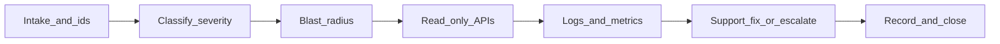

# Operational diagnostics and support workflow (paid pilots)

Goal: **faster incident triage** for RestoCafe OS during paid pilots—clear intake, correlation ids, read-only support APIs, and explicit boundaries between **support-resolvable** work and **engineering** escalation.

**Companion docs**

| Document | Use |
|----------|-----|
| [SUPPORT_INCIDENT_TRIAGE.md](./SUPPORT_INCIDENT_TRIAGE.md) | Customer-facing `x-request-id` message, first-line checklist |
| [OBSERVABILITY.md](./OBSERVABILITY.md) | Logs, metrics, health, audit, playbook |
| [SUPPORT_TOOLING.md](./SUPPORT_TOOLING.md) | Support API matrix, gaps, audit/risk |
| [INTERNAL_SUPPORT_CONSOLE.md](./INTERNAL_SUPPORT_CONSOLE.md) | Ops-web `/internal/support` (requires `VITE_SUPPORT_CONSOLE`) |
| [socket-io-scaling.md](./socket-io-scaling.md) | Realtime / Redis / multi-replica behavior |

Support automation routes live under **`/api/v1/support/*`** and require **`x-support-api-key`** ([`support.controller.ts`](../../apps/api/src/modules/support/support.controller.ts)). The internal ops UI uses **`/api/v1/internal/support-ui/*`** with staff JWT + allowlist. There is **no hidden magic**: correlation is **`x-request-id`** (equals Pino `requestId` on API logs) per [OBSERVABILITY.md](./OBSERVABILITY.md).

---

## 1. Support workflow design

### 1.1 End-to-end flow



1. **Intake** — Capture structured fields (§5 template). Always ask for **`x-request-id`** if any HTTP error occurred.
2. **Classify severity** — Apply §4 model; set response-time expectation.
3. **Blast radius** — One branch vs whole tenant vs multiple tenants (logs/metrics); health endpoints from **same URL** the venue uses.
4. **Read-only triage** — Support APIs (§3) before mutating anything. Prefer **`GET .../summary`**, **`.../onboarding-status`**, **`.../orders/:orderId`**, **`.../audit-log`**.
5. **Logs and metrics** — Filter by `requestId`, then `tenantId` / time window; see [SUPPORT_INCIDENT_TRIAGE.md](./SUPPORT_INCIDENT_TRIAGE.md).
6. **Fix or escalate** — Commerce/suspend/reactivate/metadata per policy (audited); engineering for code defects, infra, or unclear 500s after correlation.
7. **Record** — Ticket notes: ids, resolution, whether audit trail consulted; **no unnecessary PII** in long-lived tickets.

### 1.2 Ticket intake fields (required vs optional)

Capture these **before** deep debugging; they reduce round-trips.

| Field | Required | Notes |
|-------|----------|--------|
| **Venue / trade name** | Yes | Human context |
| **Tenant slug** or **tenant id** | Yes | Resolve with `GET /api/v1/support/lookup/tenant-slug/:slug` if only slug known |
| **Branch** | If branch-scoped | Branch id (from staff URL or support branch list) |
| **Environment** | Yes | Pilot API base URL / ops-web origin the venue uses (not “localhost”) |
| **Time** | Yes | Venue local time **and** UTC of first failure |
| **User role** | If relevant | Floor / kitchen / bar / manager |
| **Order id** | If payment/order issue | For `GET .../orders/:orderId` |
| **`x-request-id`** | **Strongly required** for HTTP errors | From error UI, response header, or Network tab ([SUPPORT_INCIDENT_TRIAGE.md](./SUPPORT_INCIDENT_TRIAGE.md)) |
| **Steps to reproduce** | Yes | Short, ordered |
| **Blast radius** | Yes | “Only table 3” vs “whole floor” vs “all branches” |
| **Recent change** | Optional | Menu deploy, new Wi‑Fi, new tablet, release window |

### 1.3 Tenant / branch / environment context (what to pull via API)

After intake, use the support key (curl or [internal console](./INTERNAL_SUPPORT_CONSOLE.md)):

| Goal | Endpoint |
|------|----------|
| Confirm tenant exists; billing snapshot | `GET /api/v1/support/tenants/:tenantId/summary` |
| List branch ids/slugs | `GET /api/v1/support/tenants/:tenantId/branches` |
| Blocking onboarding / “why is setup red?” | `GET /api/v1/support/tenants/:tenantId/branches/:branchId/onboarding-status` |
| Order state (stuck / paid?) | `GET /api/v1/support/tenants/:tenantId/orders/:orderId` |
| Recent business/support actions | `GET /api/v1/support/tenants/:tenantId/audit-log?limit=50&branchId=` (optional `actionPrefix`, e.g. `support.`) |
| Process + deploy identity | `GET /api/v1/support/diagnostics` — `status`, `summary`, `db`, `redis`, dependency detail, `version`, `gitSha`, `uptimeSec`, `metricsEnabled` ([`diagnostics()`](../../apps/api/src/modules/support/support.service.ts)) |

**Health (no key):** `GET /api/v1/health/live`, `GET /api/v1/health/ready` — through the **same** hostname/TLS path as customers. Readiness now returns `healthy`, `degraded`, or `not_ready`, plus DB/Redis dependency detail ([OBSERVABILITY.md](./OBSERVABILITY.md)).

### 1.4 Request IDs and correlation (non-negotiable)

- **Single correlation field:** `x-request-id` on responses; mirrored in structured logs as `requestId`.
- **Support workflow:** Paste `requestId` into log search first—fastest path to stack/status on that call.
- **Audited actions:** Business and support mutations also land in **`AuditLog`**; use for *what happened to this tenant/order*, not for replacing HTTP trace for a single 500.

### 1.5 Safety and auditing

- **Read-only first:** Summary, branches, onboarding, order lookup, audit tail—no customer impact.
- **Mutations** (commerce patch, suspend, reactivate, metadata, reset-demo) are **audited** (`support.*` actions in `AuditLog`); use only with ticket context and policy. See [SUPPORT_TOOLING.md](./SUPPORT_TOOLING.md) §Audit.
- **Do not** paste `SUPPORT_API_KEY` or JWTs into customer-visible tickets or chat logs.
- **Per-tenant HTTP error stream** is **not** in the API v1—forensics stay in **log pipeline** ([SUPPORT_TOOLING.md](./SUPPORT_TOOLING.md) gaps).

---

## 2. Diagnostics matrix by incident type

Use this to get to a **first useful diagnosis** quickly. “Support” = first-line with support key + runbooks; “Engineering” = code change, infra, or DB migration—**after** health + `requestId` + blast radius are known.

| Symptom | First checks (ordered) | Likely causes | Support can | Engineering if |
|---------|------------------------|---------------|-------------|------------------|
| **Orders stuck** (draft/confirmed, not progressing) | `orderLookup`; compare `status`, `version`, `updatedAt`; audit log for `order.*` / payment actions | Stale UI; branch mismatch; idempotency retry confusion; rare bug | Confirm correct branch/order id; ask staff refresh/reopen; verify not PAID/CANCELLED in API | Repeated inconsistent state; 409/500 on transitions with `requestId` in logs |
| **Kitchen / bar not updating** | Health green; `diagnostics` (same deploy as venue); metrics `websocket_authenticated_connections`; logs `ws_` / branch room | JWT expiry; tab backgrounded; **multi-replica Socket.IO without Redis** ([socket-io-scaling.md](./socket-io-scaling.md)); Wi‑Fi drop on device | Confirm single vs multi replica config with ops; ask hard refresh / re-login | Redis adapter misconfig; 5xx on WS upgrade path; sustained WS errors in logs |
| **QR / guest menu not loading** | Tenant `summary` + branch `onboarding-status` (public URL / QR flags); venue checklist [VENUE_INSTALLATION_CUTOVER.md](./VENUE_INSTALLATION_CUTOVER.md) | **`APP_PUBLIC_URL`** missing/wrong; trial/suspension; TLS/DNS on guest network | Point to ops for env; explain session-token vs table QR | API 5xx on public routes; CORS misconfig at edge |
| **Close bill failed** | `requestId` → logs; `orderLookup` (`status`, `paidAt`); Redis/idempotency errors in logs if multi-instance | Duplicate close retry; lock contention; payment edge case | Verify order not already PAID; one retry with idempotency awareness per runbook | `unhandled_exception` on payment close; Redis down |
| **Branch appears empty** (no tables/menu) | `onboarding-status`; `summary` counts (`menuItems`, `floorTables`); wrong **branch** selected in UI | Empty branch; user on wrong branch; onboarding incomplete | Identify correct `branchId`; guide Setup/menu/floor | Data migration issue if counts wrong in DB vs UI |

**Known limitations (not fixed in triage):** Guest Wi‑Fi quality; thermal printer drivers; peak-hour latency—[VENUE_INSTALLATION_CUTOVER.md](./VENUE_INSTALLATION_CUTOVER.md). **Do not** assume a code deploy fixes RF interference.

---

## 3. Required tooling or docs

| Need | Tooling |
|------|---------|
| Correlation | Browser DevTools → Network → failed request → **`x-request-id`**; log search by `requestId`, `tenantId` |
| Health | `GET /api/v1/health/live`, `/ready` |
| Deploy identity | `GET /api/v1/support/diagnostics` → `status`, `version`, `gitSha`, `db`, `redis` |
| Tenant/branch/order | Support read APIs ([SUPPORT_TOOLING.md](./SUPPORT_TOOLING.md)); optional **Support Console** ([INTERNAL_SUPPORT_CONSOLE.md](./INTERNAL_SUPPORT_CONSOLE.md)) |
| Metrics | Prometheus: `http_*`, `restocafe_business_events_total`, WebSocket gauges ([OBSERVABILITY.md](./OBSERVABILITY.md) §3) |
| Audit | `GET .../audit-log` with `branchId` / `actionPrefix` |
| Alerts / on-call | [PILOT_RELEASE_GATE.md](./PILOT_RELEASE_GATE.md) B12; alert annotations pointing to OBSERVABILITY + this doc |
| Venue context | [VENUE_INSTALLATION_CUTOVER.md](./VENUE_INSTALLATION_CUTOVER.md) |

---

## 4. Escalation model

### 4.1 Severity model (pilot-friendly)

| Level | Definition | Initial response | Who |
|-------|------------|------------------|-----|
| **SEV1** | Orders/payments stopped venue-wide; or data loss risk; or health **down** | Immediate | On-call + support lead |
| **SEV2** | Major degradation: realtime down for all staff; repeated 5xx on pay/close | Within 15 min | On-call |
| **SEV3** | Partial: one branch, workaround exists (e.g. paper); single user | Same business day | Support + async eng |
| **SEV4** | Questions, training, config clarification | Best effort | Support |

Upgrade severity if **blast radius** grows or **financial** impact is unclear.

### 4.2 Support vs engineering

| Typically **support** (with runbooks + support API) | Typically **engineering** |
|-----------------------------------------------------|-----------------------------|
| Wrong branch selected; refresh/relogin | Bug in state machine with repro + `requestId` |
| Trial/suspend/commerce policy ([COMMERCIAL_LIFECYCLE.md](./COMMERCIAL_LIFECYCLE.md)) | Incorrect idempotency under load |
| Onboarding steps incomplete; `APP_PUBLIC_URL` handoff to ops | Socket.IO cross-node without Redis |
| “How to read audit log” | New 500s after release; need code + deploy |
| Escalation **payload** already prepared | DB migration / rollback decision |

### 4.3 Escalation payload (minimum)

Include: **tenant id**, **branch id**, **order id** (if any), **`x-request-id`**, **timestamp** (local + UTC), **user action**, **`gitSha`/`version`** from `diagnostics`, **blast radius**, **what support already tried**.

---

## 5. Response checklist templates

### 5.1 Intake (copy for ticket)

```
Venue:
Tenant slug / id:
Branch (name + id if known):
Environment (API URL + ops-web URL):
Time (venue local + UTC):
Role (floor / kitchen / bar / manager):
Order id (if any):
x-request-id (required if error shown):
Blast radius (one table / one branch / all):
Steps to reproduce:
Recent changes (release / network / device):
```

### 5.2 First-response (support)

```
[ ] Severity assigned (SEV1–4)
[ ] Blast radius: one branch / whole tenant / multi-tenant
[ ] health/live + health/ready from customer-facing URL
[ ] GET /support/diagnostics (status, version, gitSha, db, redis)
[ ] GET .../summary + .../branches + .../onboarding-status (as needed)
[ ] Log search: requestId = _______
[ ] If order issue: GET .../orders/:orderId
[ ] If dispute: audit-log sample for order/payment actions
[ ] Resolution or escalation payload prepared
```

### 5.3 Engineering handoff

```
requestId(s): 
tenantId / branchId / orderId:
gitSha at time of incident:
Hypothesis from logs:
Customer impact window:
Support already tried:
```

---

## 6. Implementation priorities

Priorities build on [SUPPORT_TOOLING.md](./SUPPORT_TOOLING.md) §Implementation priority and pilot reality.

| Priority | Item | Rationale |
|----------|------|-----------|
| P0 | Train support on **intake + `x-request-id`** + matrix §2 | Largest TTR reduction |
| P0 | Ensure **logs** retain `requestId`, `tenantId`, `branchId`; **metrics** and **alerts** live in pilot | [OBSERVABILITY.md](./OBSERVABILITY.md) §6 checklist |
| P1 | **Internal support console** enabled on a **non-public** host for read paths | Fewer curl errors |
| P1 | Link **alerts** to this doc + [SUPPORT_INCIDENT_TRIAGE.md](./SUPPORT_INCIDENT_TRIAGE.md) | Faster on-call |
| P2 | Optional **`x-support-operator`** (or similar) on support routes for audit actor | Traceability for mutations ([SUPPORT_TOOLING.md](./SUPPORT_TOOLING.md)) |
| P2 | Read/write key split or IdP for support | Reduce blast radius of leaked key |
| P3 | **Curated per-tenant error view** (if product invests) | Log search / saved queries: [SUPPORT_LOG_QUERIES.md](./SUPPORT_LOG_QUERIES.md) (no API v1 stream) |

---

## Revision

When pilot processes change, update this doc together with [SUPPORT_INCIDENT_TRIAGE.md](./SUPPORT_INCIDENT_TRIAGE.md) and [SUPPORT_TOOLING.md](./SUPPORT_TOOLING.md) so intake fields and endpoints stay in sync with [`support.controller.ts`](../../apps/api/src/modules/support/support.controller.ts).
