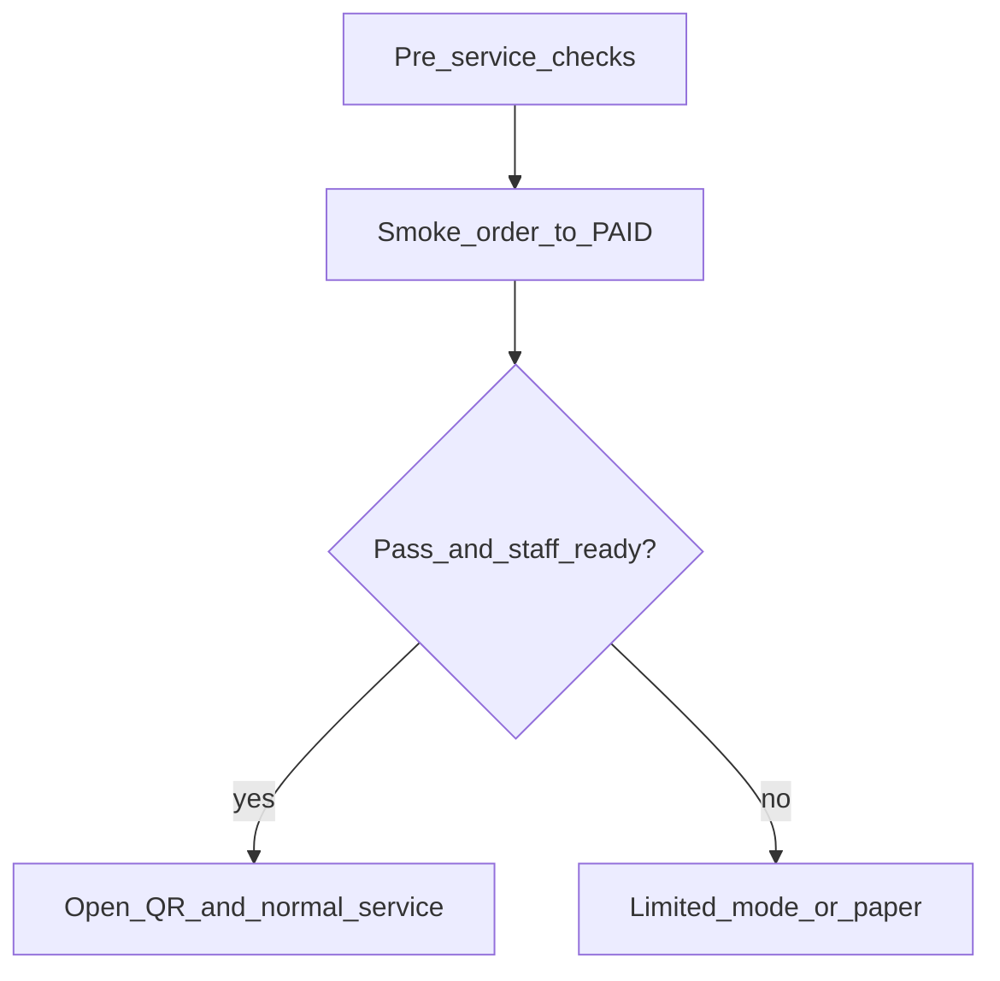

# Venue installation and cutover package (RestoCafe OS)

Floor-first checklist for a **real** pilot: staff, devices, Wi-Fi, and service pressure. This document complements engineering gates and does **not** replace them.

**Related documentation**

| Document | Role |
|----------|------|
| [PILOT_RELEASE_GATE.md](./PILOT_RELEASE_GATE.md) | Engineering/ops blocking gates (Redis, Socket.IO, health, CI, backups, rollback images, week-1 metrics). |
| [PILOT_CUTOVER_CHECKLIST.md](./PILOT_CUTOVER_CHECKLIST.md) | Worksheet: tenant/branch IDs and cross-walk to B-gates. |
| [ONE_DAY_PILOT_RUNBOOK.md](./ONE_DAY_PILOT_RUNBOOK.md) | Same-day provisioning and staff path (`/login` → `/setup` → menu/floor/smoke). |
| [QA_STRATEGY.md](../qa/QA_STRATEGY.md) §5 | UAT bullets (venue setup, service modes, roles, edge cases, reporting). |

**Product context (this repo)**

- **Staff app:** ops-web (`/floor`, `/kitchen`, `/bar`, `/setup`). Guest menu URLs need **`APP_PUBLIC_URL`** on the API (see in-app **Setup** page, [`SetupPage.tsx`](../../apps/ops-web/src/pages/SetupPage.tsx)).
- **Flows to validate on-site:** dine-in with table session and kitchen/bar tickets; takeaway; guest QR menu and waiter call ([QA_STRATEGY.md](../qa/QA_STRATEGY.md)); payments/close with idempotency expectations in the real environment ([PILOT_RELEASE_GATE.md](./PILOT_RELEASE_GATE.md) B1).
- **Realtime:** Socket.IO scaling depends on deployment (Redis, replicas). Stable venue LAN/WAN still matters—Wi-Fi quality is not “fixed by code” ([PILOT_RELEASE_GATE.md](./PILOT_RELEASE_GATE.md) B2).

**Known limitations to acknowledge before go-live**

- **Receipts / printers:** No ESC/POS driver ships in this repo; use browser/OS print, vendor drivers, or a print bridge. Paper width (80mm vs 58mm) must match the physical printer ([SetupPage.tsx](../../apps/ops-web/src/pages/SetupPage.tsx) “Printers & receipts”).
- **Cash / shift:** Structured open shift and cash drawer tracking are not fully wired in the API—use your existing cash procedures until product supports them ([SetupPage.tsx](../../apps/ops-web/src/pages/SetupPage.tsx) “Cashier & opening shift”).

---

## 1. Venue readiness checklist

### Infrastructure and site

- [ ] Primary internet line identified; **contingency** agreed (e.g. 4G failover or “slow mode” procedure)—record who switches it.
- [ ] Router/AP **placement** covers floor, kitchen, and guest seating; dead zones walked with a phone (not only a desk test).
- [ ] **Staff Wi-Fi** vs **guest Wi-Fi** policy: if one shared SSID, acknowledge contention at peak; if separate, staff devices use the staff network only.
- [ ] **DNS/HTTPS** for API and ops-web hostnames resolve correctly **from the venue network** (not only from office VPN).

### Devices

- [ ] Inventory: each tablet/phone/PC **assigned to a role** (floor, kitchen, bar, manager); charging cables and **non-sleep** policy for wall-mounted displays (see Setup page for kitchen/bar screens).
- [ ] OS updates deferred or completed outside service window; **auto-update** disabled or scheduled so browsers cannot restart mid-service.
- [ ] **Browser:** supported channel locked (Chrome/Edge recommended for ops-web); one “golden” build tested against staging.

### Printing and cashier hardware

- [ ] Receipt path chosen: **browser print dialog** vs **thermal + vendor driver/bridge**; test print for **80mm vs 58mm** width alignment.
- [ ] **Network printers:** static IP or stable DHCP reservation; firewall allows staff device → printer.
- [ ] **Cash:** physical drawer and process unchanged; POS shift features in product do **not** replace your manual policy until enabled.

### QR and guest experience

- [ ] **`APP_PUBLIC_URL`** set so guest URLs are full HTTPS links (Setup page shows the pattern or a warning if missing).
- [ ] **Per-table QR strategy:** static table QR (if used) vs session-token URLs—staff trained which model you use; mitigate wrong-table risk (table numbers on stands).
- [ ] QR **physical placement:** laminate/weather, glare, height; spot-check scan distance in **evening lighting**.

### Data and accounts

- [ ] Branch **timezone and currency** correct ([QA_STRATEGY.md](../qa/QA_STRATEGY.md) §5).
- [ ] **Menu** matches paper/legal pricing; modifiers and prep stations (kitchen vs bar) correct.
- [ ] **Floor plan** matches physical tables.
- [ ] **Staff accounts:** owner/manager plus floor, kitchen, and bar as needed; device unlock/password policy; avoid shared “kitchen login” unless risk is explicitly accepted.
- [ ] **Training slot** completed: at least one full dine-in, one takeaway, and one **network blip** drill ([QA_STRATEGY.md](../qa/QA_STRATEGY.md) edge cases).

### Paper fallback kit (pre-positioned)

- [ ] Paper menus or simplified list; **order pads**; pen; calculator; EOD tally worksheet; optional “manual service” door sign (see section 4).

---

## 2. On-site validation steps (must be tested at the venue)

Run during a **quiet window** before live traffic. Record pass/fail and device identifiers.

| Step | What to prove | Failure = block or waiver |
|------|----------------|----------------------------|
| **A. Path & TLS** | From staff and guest phones: health/login loads; no certificate warnings. | Block |
| **B. Role logins** | Each role logs in and reaches expected screens (floor, kitchen, bar). | Block |
| **C. Table session → QR** | Open session on floor; scan with **guest** phone; menu loads; waiter call visible to staff if enabled. | Block for QR go-live |
| **D. Dine-in lifecycle** | Order → kitchen/bar tickets → prep states → served → **pay/close** → table available. | Block |
| **E. Takeaway** | Counter order without table through paid. | Block if takeaway is in scope |
| **F. Move / merge** | Move order between tables; merge draft orders per policy. | Waivable if rare |
| **G. Permissions** | User without discount permission cannot apply discount; only authorized role closes/pays. | Block |
| **H. Network blip** | Airplane mode 10–30s on one ops device; UI recovers or shows clear error; no duplicate payment without staff re-check ([QA_STRATEGY.md](../qa/QA_STRATEGY.md)). | Behavior must be acknowledged |
| **I. Printer** | At least one **real** receipt print from the device that will run service. | Waivable with explicit “manual receipt” sign-off |
| **J. Reporting** | Spot-check end-of-period totals vs manual tally for the test session. | Block for finance-sensitive venues |

**Accepted as known limitations** (not fixed by repeating the same test): flaky guest Wi-Fi; Bluetooth printer quirks; browser print preview differences; peak-hour latency when uplink is saturated. **Mitigate operationally** (dedicated staff SSID, QoS, reducing HD streaming on guest Wi-Fi during rush).

---

## 3. Cutover checklist (opening day / go-live window)

### T-24 to T-1 (engineering/ops)

Per [PILOT_RELEASE_GATE.md](./PILOT_RELEASE_GATE.md):

- [ ] Gates B1–B17 satisfied or **signed waivers** with named owners.
- [ ] Final backup (B8); migration/deploy plan reviewed.
- [ ] Deployed **`APP_VERSION` / `GIT_SHA`** recorded on the ticket (day-of section in release gate).

### T-day (venue)

- [ ] **Communicate** to staff: start time, escalation contact, and what “pause service” means.
- [ ] **Positions live:** floor, kitchen, bar devices logged in **before** guests arrive.
- [ ] **Smoke order** in production: one table, full path to PAID ([ONE_DAY_PILOT_RUNBOOK.md](./ONE_DAY_PILOT_RUNBOOK.md)).
- [ ] **QR stands** placed; table numbers verified against the floor plan.
- [ ] **Cash drawer / paper** procedures ready (see known limitations above).
- [ ] **Go/no-go:** if smoke fails, do not open QR-heavy service—use fallback (section 4).

---

## 4. Rollback / fallback plan

### Application rollback (engineering)

- Redeploy previous **API** and **ops-web** artifacts; the **database** may not match older code—restore from backup if required ([PILOT_RELEASE_GATE.md](./PILOT_RELEASE_GATE.md) §5).

### Operational fallback to paper (venue)

- **Example triggers:** prolonged outage; payment or duplication risk staff cannot safely manage; kitchen display down with no workaround.
- **Actions:** Switch to **paper orders** and **manual payment tracking**; disable or cover QR codes to avoid ghost digital orders; the **manager** is the single authority for “system off.”
- **Data hygiene:** Log start/end times of fallback; reconcile manual tickets to the system later with a clear **cutover timestamp**.
- **Guest communication:** One agreed phrase (e.g. “our ordering system is paused; we’re taking your order at the table”).

Rollback here does **not** mean “fix Wi-Fi in code”—it means **controlled manual operation** until the stack and venue network are stable.

---

## 5. Day-one monitoring requirements

### Engineering/ops

From [PILOT_RELEASE_GATE.md](./PILOT_RELEASE_GATE.md) §6:

- Error rate / 5xx; `/api/v1/health/live` and `/ready` probes; business metrics (`order_paid` if enabled); WebSocket connection signals; logs for payments, idempotency, and Redis issues.

### Venue-side

- **Named support/contact** on-site or reachable within **15 minutes** for the first service period (align with B12).
- **Staff channel** (e.g. group chat): who reports incidents; include **`x-request-id`** when escalating ([SUPPORT_INCIDENT_TRIAGE.md](./SUPPORT_INCIDENT_TRIAGE.md)).
- **Manager end-of-day:** any failed payments, tables stuck in a bad state, whether paper fallback was used; **one** reconciliation pass against reports.

---

## 6. Signoff criteria before “go live”

| Criterion | Owner |
|-----------|--------|
| [PILOT_RELEASE_GATE.md](./PILOT_RELEASE_GATE.md) **Go** (or documented waivers) | Eng/Ops |
| **UAT** signed: manager name, date, **branch id** (B14; [QA_STRATEGY.md](../qa/QA_STRATEGY.md) §5) | Pilot venue |
| **Printer/network caveats** written acknowledgment (B15) | Pilot venue |
| On-site validation **A–J** complete or **explicit waivers** with risk owner | Pilot + product |
| **Fallback kit** and engineering **rollback** understood by venue manager | Pilot venue |
| **Support presence** for first live service window agreed | Ops |

---

## Venue go/no-go (day one)

**Principle:** Hardware and venue networks are **validated on-site**. Shipping code does not replace ESC/POS drivers, Wi-Fi coverage, or staff training.
