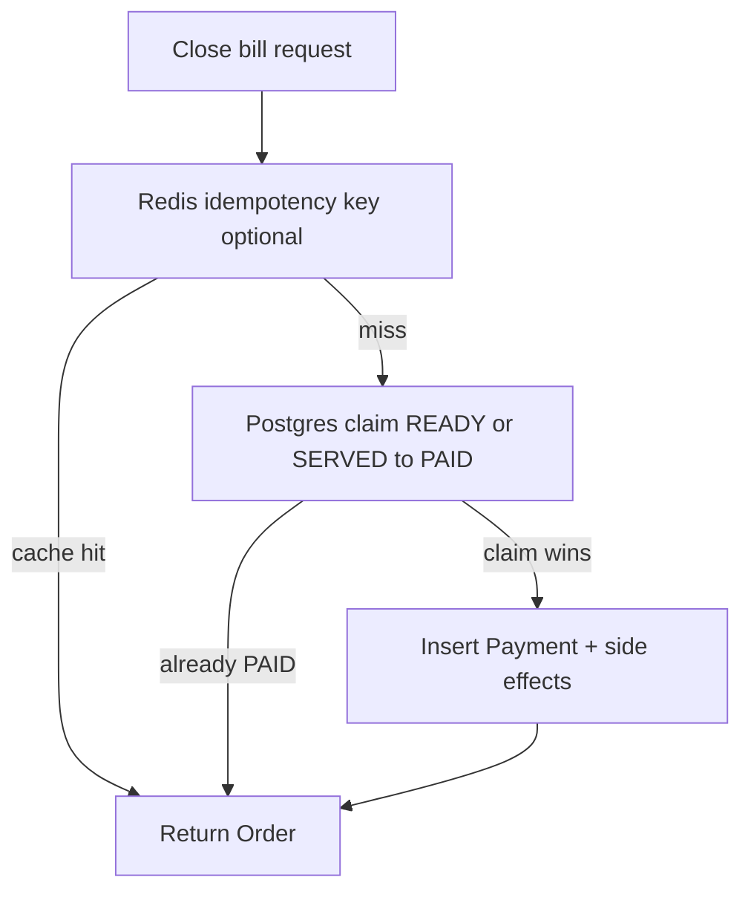

# Distributed idempotency — close bill (design)

Focused implementation for **pilot-scale** horizontal API replicas. Not a generic idempotency framework.

## 1. Critical mutation flows (inventory / money)

| Flow | Risk | Mitigation in codebase |
|------|------|------------------------|
| **POST …/orders/:orderId/close** | Duplicate payment rows, double stock moves, duplicate audit | **Redis** optional `Idempotency-Key` replay; **Postgres atomic claim** (`UPDATE … WHERE status IN (READY,SERVED)`) so concurrent closes cannot both insert `Payment` |
| **Record payment** | Same as close | Only path is `OrderBillingService.executeCloseBill` → `payment.create` |
| **Order “finalization” to PAID** | Same | Same transaction as payment |
| **Other cashier mutations** (confirm, discount, served, tickets) | Duplicate annoyance / wrong state | FSM + `version` / status checks; **not** idempotency-keyed in v1 — retries should refetch order state |

**Out of scope for this pass:** global idempotency keys on every POST. Highest ROI is **close bill** (money + stock).

## 2. Model (two layers)

1. **Application idempotency (optional header)**  
   - Header: `Idempotency-Key` (trimmed).  
   - Key: `closeBill:{tenantId}:{orderId}:{clientKey}`.  
   - Value: `orderId` (same as order id being closed).  
   - TTL: **10 minutes** for the value mapping.  
   - **Lock key**: same logical key + `:lock`, `SET <random-token> NX PX` (**90s** lock TTL; token stored as value).  
   - **Release:** Lua script deletes the lock **only if** the value still matches the holder’s token, so a slow `finally` cannot remove another request’s lock after TTL expiry.  
   - If lock not acquired: poll GET value up to **6s** (`120 × 50ms`); then **503** `idempotency_in_progress` (client retry with backoff).  
   - Lock always **released in `finally`**; if the process dies, the lock **expires** at **90s** (must exceed worst-case close-bill latency).

2. **Database idempotency (always on)**  
   - If the order is **already `PAID`** before the transaction (e.g. retry after commit, or sequential duplicate close), the handler returns the order immediately and **backfills** the Redis idempotency value when `Idempotency-Key` is present — no invalid `PAID → PAID` transition error.  
   - Inside a **single Prisma transaction**: `UPDATE "Order" SET status = PAID … WHERE id AND branchId AND tenantId AND status IN (READY, SERVED)`.  
   - **One** row updated ⇒ this replica won the race; proceed to `payment.create` and stock/session updates.  
   - **Zero** rows updated ⇒ re-read order; if `status === PAID`, treat as **idempotent success** (no second payment, no duplicate stock).  
   - Otherwise **409** `order_cannot_be_paid`.

**Tradeoff:** Without `Idempotency-Key`, clients still get safe **at-most-one payment** under concurrency (DB claim). With the key, safe **retries** after unknown outcomes plus faster replay from Redis.

## 3. Key / schema strategy

| Artifact | Format |
|----------|--------|
| Redis value key | `closeBill:{tenantId}:{orderId}:{idempotencyKey}` |
| Redis lock key | `closeBill:{tenantId}:{orderId}:{idempotencyKey}:lock` |
| Value | Order id string (opaque; equals `orderId` for this operation) |
| Postgres | No new tables; uniqueness of “one successful close” enforced by **transition claim**, not `@@unique` on `Payment` (optional future hardening) |

## 4. Lock and retry lifecycle

| Phase | Behavior |
|-------|----------|
| **Happy path** | `acquireLock` → transaction (claim → pay) → `set` value TTL 10m → `releaseLock` |
| **Duplicate same key (Redis)** | `get` hits → return order; no DB write |
| **Contention same key** | Second writer fails `NX`; polls GET; winner writes value; reader returns same order |
| **Lock holder crash** | Lock TTL **90s**; no permanent deadlock. Late duplicate may hit **DB already-PAID** or **early PAID** path |
| **Value TTL expiry (10m)** | Client must use a **new** idempotency key for a deliberate second operation; business rule is still one close per order |

## 5. Failure paths

- **Transaction rollback:** No `PAID` transition, no payment row; lock released; retry safe.  
- **After commit, before Redis `set`:** Retry with same idempotency key may run DB path → **already PAID** → response OK; Redis `set` backfilled.  
- **After commit, audit/emit throws:** Order remains PAID; retry is idempotent via DB (and Redis once set).

## 6. Multi-replica safety

- **Redis:** Shared idempotency map + short lock when `REDIS_URL` is set.  
- **Postgres:** Row-level `UPDATE` serialization prevents two payments for the same order when both saw `READY`/`SERVED`.

## 7. Operational notes

- **Single Node / no Redis:** In-memory idempotency + same DB claim — still safe for duplicate payment **if** DB is shared (typical).  
- **Require `REDIS_URL`** when running **multiple** API replicas so idempotency keys and locks are shared.  
- See also: [`idempotency-and-offline.md`](./idempotency-and-offline.md).
