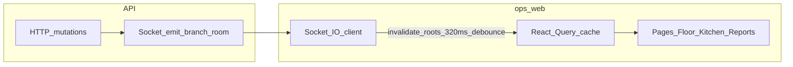

# Frontend operational performance audit — ops-web

Canonical copy of the ops-web operational performance review. React Query defaults live in [`apps/ops-web/src/main.tsx`](../../apps/ops-web/src/main.tsx); realtime invalidation in [`apps/ops-web/src/lib/branch-realtime.tsx`](../../apps/ops-web/src/lib/branch-realtime.tsx).

## Evidence base (key files)

- Global React Query + realtime: [`main.tsx`](../../apps/ops-web/src/main.tsx), [`branch-realtime.tsx`](../../apps/ops-web/src/lib/branch-realtime.tsx)
- Branch ID source: [`api.ts`](../../apps/ops-web/src/lib/api.ts) (`getBranchId()` reads `localStorage`, kept in sync with Zustand in [`auth-store.ts`](../../apps/ops-web/src/lib/auth-store.ts)). Branch-scoped pages should use [`useBranchId()`](../../apps/ops-web/src/lib/use-branch-id.ts) so query keys track the store if an in-app branch switcher ships without full navigation.
- Representative pages: [`KitchenPage.tsx`](../../apps/ops-web/src/pages/KitchenPage.tsx), [`FloorPage.tsx`](../../apps/ops-web/src/pages/FloorPage.tsx), [`OpenOrdersPage.tsx`](../../apps/ops-web/src/pages/OpenOrdersPage.tsx), [`ReportsPage.tsx`](../../apps/ops-web/src/pages/ReportsPage.tsx), [`SetupPage.tsx`](../../apps/ops-web/src/pages/SetupPage.tsx), [`CustomerLookupPage.tsx`](../../apps/ops-web/src/pages/CustomerLookupPage.tsx)

---

## 1. Frontend performance hot spots

| Area | What happens | Why it matters under load |
|------|----------------|---------------------------|
| **Realtime invalidation fan-out** | [`branch-realtime.tsx`](../../apps/ops-web/src/lib/branch-realtime.tsx) debounces 320ms, then invalidates by query “root” (`tickets`, `tables`, `open-orders`, `reports`, `ops-snapshot`). For **`ticket.updated`** events, the server may include `station: 'KITCHEN' \| 'BAR'`; the client then invalidates only `['tickets', station, branchId]` when the batch contains no broader ticket events. Otherwise `tickets` uses a **predicate** matching all `queryKey[0] === 'tickets'` queries. | Narrowing reduces redundant kitchen/bar refetches when payloads are tagged; mixed batches still refetch both stations when needed. |
| **Unknown / new event names** | Fallback invalidates a **narrower** set in production (`tickets`, `tables`, `open-orders`); development still uses the full five-root fallback and logs a warning. | Prevents unregistered server events from amplifying HTTP to `reports` / `ops-snapshot`. |
| **Reports page mount** | [`ReportsPage`](../../apps/ops-web/src/pages/ReportsPage.tsx) orchestrates queries; heavy panels live under [`pages/reports/`](../../apps/ops-web/src/pages/reports/) with **lazy** + `Suspense` for permission-gated blocks (e.g. tenant rollup). Query keys are unchanged. | Entering `/reports` still triggers parallel API work for visible panels; lazy chunks defer code and some tree work until needed. |
| **Setup page** | Large page with commerce, onboarding, config snapshot, QR `useEffect`, multiple mutations each invalidating onboarding/config. | Long-lived component tree + async QR generation; more **main-thread** work on low-end tablets. |
| **Kitchen / bar** | [`KitchenPage`](../../apps/ops-web/src/pages/KitchenPage.tsx): `refetchInterval` 12s when WS down and tab visible, 60s when WS up, **paused** when tab hidden. | Good for battery; when WS flaps, **polling + invalidation** can overlap. |

---

## 2. Rendering risks

- **Large pages**: `ReportsPage` is split into submodules; `SetupPage` still combines many concerns—watch parent state vs subtree updates when profiling.
- **List virtualization**: [`KitchenPage`](../../apps/ops-web/src/pages/KitchenPage.tsx) and [`OpenOrdersPage`](../../apps/ops-web/src/pages/OpenOrdersPage.tsx) use `@tanstack/react-virtual` when list length exceeds a fixed threshold (currently **> 28** rows); below that, full list render remains.
- **Branch id**: Branch-scoped pages use [`useBranchId()`](../../apps/ops-web/src/lib/use-branch-id.ts) (Zustand) so query keys stay aligned if an in-app branch switch avoids navigation. Socket/realtime helpers may still read `getBranchId()` where appropriate.
- **StrictMode** ([`main.tsx`](../../apps/ops-web/src/main.tsx)): double `useEffect` in dev can double socket connect cycles; minor for ops, worth knowing when profiling.

---

## 3. Network inefficiency list

- **Ticket invalidation**: When the server emits `ticket.updated` with `station`, only that station’s `['tickets', station, branchId]` query is invalidated; batches that include other ticket-related events or untagged updates still use the full tickets predicate.
- **Reports invalidation scope**: Invalidation uses `queryKey[0] === 'reports' && queryKey[1] === branchId`, so it targets **daily** report (`['reports', branchId, date]`) and avoids churn on `['reports','tenant-rollup',…]`, `['reports','visit-signals',…]`, `['reports','demand-profile',…]`—**intentionally narrower**; ops snapshot still refetches with floor.
- **ORDER_UPDATED / ORDER_*** events often include **`reports`** in the map—managers on Reports get **extra refetches** during busy service (may be acceptable; alternative is manual refresh only on Reports).
- **Default QueryClient** ([`main.tsx`](../../apps/ops-web/src/main.tsx)): `staleTime: 15s`, `refetchOnWindowFocus: false`—**tablet-friendly** (avoids focus storms). Per-query overrides (e.g. kitchen `staleTime: 8s`) are coherent.
- **Customer search** ([`CustomerLookupPage`](../../apps/ops-web/src/pages/CustomerLookupPage.tsx)): search runs on **button/Enter** (`qParam` in URL), not per keystroke—**good** (no typeahead storm).

---

## 4. Long-session stability risks

- **Socket.IO**: Reconnect backoff and `reconnect` handler call `resyncAfterReconnect` (invalidates tickets, open-orders, tables, ops-snapshot, branch-scoped reports)—reduces **drift** after outages.
- **IndexedDB offline queue** ([`offline-queue.ts`](../../apps/ops-web/src/lib/offline-queue.ts)): Dexie DB `restocafe-ops`; long sessions could accumulate queued rows if drain fails—**monitoring** of queue depth is an ops concern (not visible in UI here).
- **Memory**: Single socket per [`BranchRealtimeProvider`](../../apps/ops-web/src/lib/branch-realtime.tsx); cleanup removes listeners and disconnects on `accessToken`/`branchId` change—**low leak risk** if effect deps stay correct. Large report payloads held in React Query cache until GC/eviction—**bounded** by navigation and query keys.
- **QR generation** ([`SetupPage`](../../apps/ops-web/src/pages/SetupPage.tsx)): `QRCode.toDataURL` in `useEffect` with cancel flag—reasonable; repeated URL edits regenerate images.

---

## 5. UI responsiveness risks

- **Main-thread work**: Heavy **reports** JSON + multiple `useMemo` passes on large structures can jank low-end devices when data updates.
- **Concurrent refetch + mutation**: Kitchen advances ticket via mutation then invalidates same query; overlapping with WS invalidation can cause **redundant** refetches (usually consistent, not blocking).
- **Open bills**: Uses adaptive HTTP polling when Socket.IO is disconnected (aligned with kitchen) so open bills stay fresher during WS outages.
- **Floor grid**: Two queries (`tables`, `ops-snapshot`); adaptive HTTP polling when Socket.IO is down (same policy as kitchen / open bills).

---

## 6. Prioritized refactor / optimization list

**P1 — High impact / lower risk**

1. **Ticket invalidation**: Server tags `ticket.updated` with `station` when applicable; client narrows invalidation when possible (see `branch-realtime.tsx`).
2. **Split `ReportsPage`**: Panels under `pages/reports/` with lazy + `Suspense` for permission-gated sections; query keys unchanged.
3. **Harden unknown realtime events**: Production uses a narrower fallback; development logs unknown event names (see `branch-realtime.tsx`).
4. **OpenOrdersPage parity with kitchen**: When `useBranchRealtimeConnected() === false`, conservative `refetchInterval` (pause when tab hidden)—implemented.
5. **Floor page parity**: `FloorPage` uses the same adaptive `refetchInterval` for `tables` and `ops-snapshot` when realtime is unhealthy.

**P2 — When profiling proves need**

6. **Virtualization** is enabled above list thresholds on Kitchen and Open Orders; tune thresholds via code/constants if pilot data warrants it.
7. **`useBranchId()`** is used on branch-scoped pages for store-aligned keys when in-app branch switching ships.
8. **React Query `notifyOnChangeProps`** or finer `select` on heavy queries to reduce re-renders (only if profiler shows issue).

**P3 — Nice to have**

9. **React Query Devtools** load in development only (`import.meta.env.DEV` in `main.tsx`).
10. Consider **prefetch** of `ops-snapshot` on route hover for Floor—micro-optimization.

